# Projects and dependencies analysis

This document provides a comprehensive overview of the projects and their dependencies in the context of upgrading to .NETCoreApp,Version=v10.0.

## Table of Contents

- [Executive Summary](#executive-Summary)
  - [Highlevel Metrics](#highlevel-metrics)
  - [Projects Compatibility](#projects-compatibility)
  - [Package Compatibility](#package-compatibility)
  - [API Compatibility](#api-compatibility)
- [Aggregate NuGet packages details](#aggregate-nuget-packages-details)
- [Top API Migration Challenges](#top-api-migration-challenges)
  - [Technologies and Features](#technologies-and-features)
  - [Most Frequent API Issues](#most-frequent-api-issues)
- [Projects Relationship Graph](#projects-relationship-graph)
- [Project Details](#project-details)

  - [src\ApiGateways\Aggregators\Web.Shopping.HttpAggregator\Web.Shopping.HttpAggregator.csproj](#srcapigatewaysaggregatorswebshoppinghttpaggregatorwebshoppinghttpaggregatorcsproj)
  - [src\BuildingBlocks\EventBus\EventBus\EventBus.csproj](#srcbuildingblockseventbuseventbuseventbuscsproj)
  - [src\BuildingBlocks\EventBus\EventBusRabbitMQ\EventBusRabbitMQ.csproj](#srcbuildingblockseventbuseventbusrabbitmqeventbusrabbitmqcsproj)
  - [src\BuildingBlocks\EventBus\EventBusServiceBus\EventBusServiceBus.csproj](#srcbuildingblockseventbuseventbusservicebuseventbusservicebuscsproj)
  - [src\BuildingBlocks\EventBus\IntegrationEventLogEF\IntegrationEventLogEF.csproj](#srcbuildingblockseventbusintegrationeventlogefintegrationeventlogefcsproj)
  - [src\BuildingBlocks\WebHost\WebHost.Customization\WebHost.Customization.csproj](#srcbuildingblockswebhostwebhostcustomizationwebhostcustomizationcsproj)
  - [src\Services\Basket\Basket.API\Basket.API.csproj](#srcservicesbasketbasketapibasketapicsproj)
  - [src\Services\Catalog\Catalog.API\Catalog.API.csproj](#srcservicescatalogcatalogapicatalogapicsproj)
  - [src\Services\Coupon\Coupon.API\Coupon.API.csproj](#srcservicescouponcouponapicouponapicsproj)
  - [src\Services\Identity\Identity.API\Identity.API.csproj](#srcservicesidentityidentityapiidentityapicsproj)
  - [src\Services\Ordering\Ordering.API\Ordering.API.csproj](#srcservicesorderingorderingapiorderingapicsproj)
  - [src\Services\Ordering\Ordering.BackgroundTasks\Ordering.BackgroundTasks.csproj](#srcservicesorderingorderingbackgroundtasksorderingbackgroundtaskscsproj)
  - [src\Services\Ordering\Ordering.Domain\Ordering.Domain.csproj](#srcservicesorderingorderingdomainorderingdomaincsproj)
  - [src\Services\Ordering\Ordering.Infrastructure\Ordering.Infrastructure.csproj](#srcservicesorderingorderinginfrastructureorderinginfrastructurecsproj)
  - [src\Services\Ordering\Ordering.SignalrHub\Ordering.SignalrHub.csproj](#srcservicesorderingorderingsignalrhuborderingsignalrhubcsproj)
  - [src\Services\Payment\Payment.API\Payment.API.csproj](#srcservicespaymentpaymentapipaymentapicsproj)
  - [src\Web\WebSPA\WebSPA.csproj](#srcwebwebspawebspacsproj)
  - [src\Web\WebStatus\WebStatus.csproj](#srcwebwebstatuswebstatuscsproj)
  - [tests\Services\Coupon\Coupon.API.Tests\Coupon.API.Tests.csproj](#testsservicescouponcouponapitestscouponapitestscsproj)

## Executive Summary

### Highlevel Metrics

| Metric | Count | Status |
| :--- | :---: | :--- |
| Total Projects | 19 | All require upgrade |
| Total NuGet Packages | 70 | 23 need upgrade |
| Total Code Files | 378 |  |
| Total Code Files with Incidents | 61 |  |
| Total Lines of Code | 23577 |  |
| Total Number of Issues | 410 |  |
| Estimated LOC to modify | 294+ | at least 1,2% of codebase |

### Projects Compatibility

| Project | Target Framework | Difficulty | Package Issues | API Issues | Est. LOC Impact | Description |
| :--- | :---: | :---: | :---: | :---: | :---: | :--- |
| [src\ApiGateways\Aggregators\Web.Shopping.HttpAggregator\Web.Shopping.HttpAggregator.csproj](#srcapigatewaysaggregatorswebshoppinghttpaggregatorwebshoppinghttpaggregatorcsproj) | net9.0 | 🟢 Low | 3 | 48 | 48+ | AspNetCore, Sdk Style = True |
| [src\BuildingBlocks\EventBus\EventBus\EventBus.csproj](#srcbuildingblockseventbuseventbuseventbuscsproj) | net9.0 | 🟢 Low | 0 | 0 |  | ClassLibrary, Sdk Style = True |
| [src\BuildingBlocks\EventBus\EventBusRabbitMQ\EventBusRabbitMQ.csproj](#srcbuildingblockseventbuseventbusrabbitmqeventbusrabbitmqcsproj) | net9.0 | 🟢 Low | 0 | 2 | 2+ | ClassLibrary, Sdk Style = True |
| [src\BuildingBlocks\EventBus\EventBusServiceBus\EventBusServiceBus.csproj](#srcbuildingblockseventbuseventbusservicebuseventbusservicebuscsproj) | net9.0 | 🟢 Low | 1 | 0 |  | ClassLibrary, Sdk Style = True |
| [src\BuildingBlocks\EventBus\IntegrationEventLogEF\IntegrationEventLogEF.csproj](#srcbuildingblockseventbusintegrationeventlogefintegrationeventlogefcsproj) | net9.0 | 🟢 Low | 4 | 0 |  | ClassLibrary, Sdk Style = True |
| [src\BuildingBlocks\WebHost\WebHost.Customization\WebHost.Customization.csproj](#srcbuildingblockswebhostwebhostcustomizationwebhostcustomizationcsproj) | net9.0 | 🟢 Low | 4 | 5 | 5+ | ClassLibrary, Sdk Style = True |
| [src\Services\Basket\Basket.API\Basket.API.csproj](#srcservicesbasketbasketapibasketapicsproj) | net9.0 | 🟢 Low | 7 | 33 | 33+ | AspNetCore, Sdk Style = True |
| [src\Services\Catalog\Catalog.API\Catalog.API.csproj](#srcservicescatalogcatalogapicatalogapicsproj) | net9.0 | 🟢 Low | 4 | 30 | 30+ | AspNetCore, Sdk Style = True |
| [src\Services\Coupon\Coupon.API\Coupon.API.csproj](#srcservicescouponcouponapicouponapicsproj) | net9.0 | 🟢 Low | 9 | 27 | 27+ | AspNetCore, Sdk Style = True |
| [src\Services\Identity\Identity.API\Identity.API.csproj](#srcservicesidentityidentityapiidentityapicsproj) | net9.0 | 🟢 Low | 9 | 24 | 24+ | AspNetCore, Sdk Style = True |
| [src\Services\Ordering\Ordering.API\Ordering.API.csproj](#srcservicesorderingorderingapiorderingapicsproj) | net9.0 | 🟢 Low | 8 | 52 | 52+ | AspNetCore, Sdk Style = True |
| [src\Services\Ordering\Ordering.BackgroundTasks\Ordering.BackgroundTasks.csproj](#srcservicesorderingorderingbackgroundtasksorderingbackgroundtaskscsproj) | net9.0 | 🟢 Low | 8 | 3 | 3+ | DotNetCoreApp, Sdk Style = True |
| [src\Services\Ordering\Ordering.Domain\Ordering.Domain.csproj](#srcservicesorderingorderingdomainorderingdomaincsproj) | net9.0 | 🟢 Low | 7 | 0 |  | ClassLibrary, Sdk Style = True |
| [src\Services\Ordering\Ordering.Infrastructure\Ordering.Infrastructure.csproj](#srcservicesorderingorderinginfrastructureorderinginfrastructurecsproj) | net9.0 | 🟢 Low | 9 | 0 |  | ClassLibrary, Sdk Style = True |
| [src\Services\Ordering\Ordering.SignalrHub\Ordering.SignalrHub.csproj](#srcservicesorderingorderingsignalrhuborderingsignalrhubcsproj) | net9.0 | 🟢 Low | 9 | 20 | 20+ | AspNetCore, Sdk Style = True |
| [src\Services\Payment\Payment.API\Payment.API.csproj](#srcservicespaymentpaymentapipaymentapicsproj) | net9.0 | 🟢 Low | 2 | 10 | 10+ | AspNetCore, Sdk Style = True |
| [src\Web\WebSPA\WebSPA.csproj](#srcwebwebspawebspacsproj) | net9.0 | 🟢 Low | 3 | 27 | 27+ | AspNetCore, Sdk Style = True |
| [src\Web\WebStatus\WebStatus.csproj](#srcwebwebstatuswebstatuscsproj) | net9.0 | 🟢 Low | 2 | 13 | 13+ | AspNetCore, Sdk Style = True |
| [tests\Services\Coupon\Coupon.API.Tests\Coupon.API.Tests.csproj](#testsservicescouponcouponapitestscouponapitestscsproj) | net9.0 | 🟢 Low | 8 | 0 |  | DotNetCoreApp, Sdk Style = True |

### Package Compatibility

| Status | Count | Percentage |
| :--- | :---: | :---: |
| ✅ Compatible | 47 | 67,1% |
| ⚠️ Incompatible | 6 | 8,6% |
| 🔄 Upgrade Recommended | 17 | 24,3% |
| ***Total NuGet Packages*** | ***70*** | ***100%*** |

### API Compatibility

| Category | Count | Impact |
| :--- | :---: | :--- |
| 🔴 Binary Incompatible | 76 | High - Require code changes |
| 🟡 Source Incompatible | 169 | Medium - Needs re-compilation and potential conflicting API error fixing |
| 🔵 Behavioral change | 49 | Low - Behavioral changes that may require testing at runtime |
| ✅ Compatible | 34235 |  |
| ***Total APIs Analyzed*** | ***34529*** |  |

## Aggregate NuGet packages details

| Package | Current Version | Suggested Version | Projects | Description |
| :--- | :---: | :---: | :--- | :--- |
| AspNetCore.HealthChecks.AzureServiceBus | 9.0.0 |  | [Basket.API.csproj](#srcservicesbasketbasketapibasketapicsproj) [Catalog.API.csproj](#srcservicescatalogcatalogapicatalogapicsproj) [Coupon.API.csproj](#srcservicescouponcouponapicouponapicsproj) [Coupon.API.Tests.csproj](#testsservicescouponcouponapitestscouponapitestscsproj) [Ordering.API.csproj](#srcservicesorderingorderingapiorderingapicsproj) [Ordering.BackgroundTasks.csproj](#srcservicesorderingorderingbackgroundtasksorderingbackgroundtaskscsproj) [Ordering.Domain.csproj](#srcservicesorderingorderingdomainorderingdomaincsproj) [Ordering.Infrastructure.csproj](#srcservicesorderingorderinginfrastructureorderinginfrastructurecsproj) [Ordering.SignalrHub.csproj](#srcservicesorderingorderingsignalrhuborderingsignalrhubcsproj) [Payment.API.csproj](#srcservicespaymentpaymentapipaymentapicsproj) | ✅Compatible |
| AspNetCore.HealthChecks.AzureStorage | 7.0.0 |  | [Catalog.API.csproj](#srcservicescatalogcatalogapicatalogapicsproj) | ⚠️NuGet package is deprecated |
| AspNetCore.HealthChecks.MongoDb | 9.0.0 |  | [Coupon.API.csproj](#srcservicescouponcouponapicouponapicsproj) | ✅Compatible |
| AspNetCore.HealthChecks.Rabbitmq.v6 | 9.0.0 |  | [Basket.API.csproj](#srcservicesbasketbasketapibasketapicsproj) [Catalog.API.csproj](#srcservicescatalogcatalogapicatalogapicsproj) [Coupon.API.csproj](#srcservicescouponcouponapicouponapicsproj) [Coupon.API.Tests.csproj](#testsservicescouponcouponapitestscouponapitestscsproj) [Ordering.API.csproj](#srcservicesorderingorderingapiorderingapicsproj) [Ordering.BackgroundTasks.csproj](#srcservicesorderingorderingbackgroundtasksorderingbackgroundtaskscsproj) [Ordering.Domain.csproj](#srcservicesorderingorderingdomainorderingdomaincsproj) [Ordering.Infrastructure.csproj](#srcservicesorderingorderinginfrastructureorderinginfrastructurecsproj) [Ordering.SignalrHub.csproj](#srcservicesorderingorderingsignalrhuborderingsignalrhubcsproj) [Payment.API.csproj](#srcservicespaymentpaymentapipaymentapicsproj) | ✅Compatible |
| AspNetCore.HealthChecks.Redis | 9.0.0 |  | [Basket.API.csproj](#srcservicesbasketbasketapibasketapicsproj) [Coupon.API.csproj](#srcservicescouponcouponapicouponapicsproj) [Coupon.API.Tests.csproj](#testsservicescouponcouponapitestscouponapitestscsproj) [Ordering.BackgroundTasks.csproj](#srcservicesorderingorderingbackgroundtasksorderingbackgroundtaskscsproj) [Ordering.Domain.csproj](#srcservicesorderingorderingdomainorderingdomaincsproj) [Ordering.Infrastructure.csproj](#srcservicesorderingorderinginfrastructureorderinginfrastructurecsproj) [Ordering.SignalrHub.csproj](#srcservicesorderingorderingsignalrhuborderingsignalrhubcsproj) | ✅Compatible |
| AspNetCore.HealthChecks.SqlServer | 9.0.0 |  | [Catalog.API.csproj](#srcservicescatalogcatalogapicatalogapicsproj) [Coupon.API.csproj](#srcservicescouponcouponapicouponapicsproj) [Coupon.API.Tests.csproj](#testsservicescouponcouponapitestscouponapitestscsproj) [Identity.API.csproj](#srcservicesidentityidentityapiidentityapicsproj) [Ordering.API.csproj](#srcservicesorderingorderingapiorderingapicsproj) [Ordering.BackgroundTasks.csproj](#srcservicesorderingorderingbackgroundtasksorderingbackgroundtaskscsproj) [Ordering.Domain.csproj](#srcservicesorderingorderingdomainorderingdomaincsproj) [Ordering.Infrastructure.csproj](#srcservicesorderingorderinginfrastructureorderinginfrastructurecsproj) [Ordering.SignalrHub.csproj](#srcservicesorderingorderingsignalrhuborderingsignalrhubcsproj) | ✅Compatible |
| AspNetCore.HealthChecks.UI | 9.0.0 |  | [Coupon.API.csproj](#srcservicescouponcouponapicouponapicsproj) [Coupon.API.Tests.csproj](#testsservicescouponcouponapitestscouponapitestscsproj) [Ordering.BackgroundTasks.csproj](#srcservicesorderingorderingbackgroundtasksorderingbackgroundtaskscsproj) [Ordering.Domain.csproj](#srcservicesorderingorderingdomainorderingdomaincsproj) [Ordering.Infrastructure.csproj](#srcservicesorderingorderinginfrastructureorderinginfrastructurecsproj) [Ordering.SignalrHub.csproj](#srcservicesorderingorderingsignalrhuborderingsignalrhubcsproj) [WebStatus.csproj](#srcwebwebstatuswebstatuscsproj) | ✅Compatible |
| AspNetCore.HealthChecks.UI.Client | 9.0.0 |  | [Basket.API.csproj](#srcservicesbasketbasketapibasketapicsproj) [Catalog.API.csproj](#srcservicescatalogcatalogapicatalogapicsproj) [Coupon.API.csproj](#srcservicescouponcouponapicouponapicsproj) [Coupon.API.Tests.csproj](#testsservicescouponcouponapitestscouponapitestscsproj) [Identity.API.csproj](#srcservicesidentityidentityapiidentityapicsproj) [Ordering.API.csproj](#srcservicesorderingorderingapiorderingapicsproj) [Ordering.BackgroundTasks.csproj](#srcservicesorderingorderingbackgroundtasksorderingbackgroundtaskscsproj) [Ordering.Domain.csproj](#srcservicesorderingorderingdomainorderingdomaincsproj) [Ordering.Infrastructure.csproj](#srcservicesorderingorderinginfrastructureorderinginfrastructurecsproj) [Ordering.SignalrHub.csproj](#srcservicesorderingorderingsignalrhuborderingsignalrhubcsproj) [Payment.API.csproj](#srcservicespaymentpaymentapipaymentapicsproj) [Web.Shopping.HttpAggregator.csproj](#srcapigatewaysaggregatorswebshoppinghttpaggregatorwebshoppinghttpaggregatorcsproj) [WebSPA.csproj](#srcwebwebspawebspacsproj) [WebStatus.csproj](#srcwebwebstatuswebstatuscsproj) | ✅Compatible |
| AspNetCore.HealthChecks.UI.InMemory.Storage | 9.0.0 |  | [Coupon.API.csproj](#srcservicescouponcouponapicouponapicsproj) [Coupon.API.Tests.csproj](#testsservicescouponcouponapitestscouponapitestscsproj) [Ordering.BackgroundTasks.csproj](#srcservicesorderingorderingbackgroundtasksorderingbackgroundtaskscsproj) [Ordering.Domain.csproj](#srcservicesorderingorderingdomainorderingdomaincsproj) [Ordering.Infrastructure.csproj](#srcservicesorderingorderinginfrastructureorderinginfrastructurecsproj) [Ordering.SignalrHub.csproj](#srcservicesorderingorderingsignalrhuborderingsignalrhubcsproj) [WebStatus.csproj](#srcwebwebstatuswebstatuscsproj) | ✅Compatible |
| AspNetCore.HealthChecks.Uris | 9.0.0 |  | [Coupon.API.csproj](#srcservicescouponcouponapicouponapicsproj) [Coupon.API.Tests.csproj](#testsservicescouponcouponapitestscouponapitestscsproj) [Ordering.BackgroundTasks.csproj](#srcservicesorderingorderingbackgroundtasksorderingbackgroundtaskscsproj) [Ordering.Domain.csproj](#srcservicesorderingorderingdomainorderingdomaincsproj) [Ordering.Infrastructure.csproj](#srcservicesorderingorderinginfrastructureorderinginfrastructurecsproj) [Ordering.SignalrHub.csproj](#srcservicesorderingorderingsignalrhuborderingsignalrhubcsproj) [Web.Shopping.HttpAggregator.csproj](#srcapigatewaysaggregatorswebshoppinghttpaggregatorwebshoppinghttpaggregatorcsproj) [WebSPA.csproj](#srcwebwebspawebspacsproj) [WebStatus.csproj](#srcwebwebstatuswebstatuscsproj) | ✅Compatible |
| Autofac | 9.0.0 |  | [Coupon.API.csproj](#srcservicescouponcouponapicouponapicsproj) [Coupon.API.Tests.csproj](#testsservicescouponcouponapitestscouponapitestscsproj) [EventBusRabbitMQ.csproj](#srcbuildingblockseventbuseventbusrabbitmqeventbusrabbitmqcsproj) [EventBusServiceBus.csproj](#srcbuildingblockseventbuseventbusservicebuseventbusservicebuscsproj) [Ordering.BackgroundTasks.csproj](#srcservicesorderingorderingbackgroundtasksorderingbackgroundtaskscsproj) [Ordering.Domain.csproj](#srcservicesorderingorderingdomainorderingdomaincsproj) [Ordering.Infrastructure.csproj](#srcservicesorderingorderinginfrastructureorderinginfrastructurecsproj) | ✅Compatible |
| Autofac.Extensions.DependencyInjection | 10.0.0 |  | [Basket.API.csproj](#srcservicesbasketbasketapibasketapicsproj) [Catalog.API.csproj](#srcservicescatalogcatalogapicatalogapicsproj) [Coupon.API.csproj](#srcservicescouponcouponapicouponapicsproj) [Identity.API.csproj](#srcservicesidentityidentityapiidentityapicsproj) [Ordering.API.csproj](#srcservicesorderingorderingapiorderingapicsproj) [Ordering.BackgroundTasks.csproj](#srcservicesorderingorderingbackgroundtasksorderingbackgroundtaskscsproj) [Ordering.SignalrHub.csproj](#srcservicesorderingorderingsignalrhuborderingsignalrhubcsproj) [Payment.API.csproj](#srcservicespaymentpaymentapipaymentapicsproj) | ✅Compatible |
| coverlet.collector | 6.0.4 |  | [Coupon.API.Tests.csproj](#testsservicescouponcouponapitestscouponapitestscsproj) | ✅Compatible |
| Dapper | 2.1.66 |  | [Ordering.API.csproj](#srcservicesorderingorderingapiorderingapicsproj) [Ordering.BackgroundTasks.csproj](#srcservicesorderingorderingbackgroundtasksorderingbackgroundtaskscsproj) | ✅Compatible |
| FluentValidation.AspNetCore | 11.3.1 |  | [Coupon.API.csproj](#srcservicescouponcouponapicouponapicsproj) [Coupon.API.Tests.csproj](#testsservicescouponcouponapitestscouponapitestscsproj) [Ordering.API.csproj](#srcservicesorderingorderingapiorderingapicsproj) [Ordering.BackgroundTasks.csproj](#srcservicesorderingorderingbackgroundtasksorderingbackgroundtaskscsproj) [Ordering.Domain.csproj](#srcservicesorderingorderingdomainorderingdomaincsproj) [Ordering.Infrastructure.csproj](#srcservicesorderingorderinginfrastructureorderinginfrastructurecsproj) | ⚠️NuGet package is deprecated |
| Google.Protobuf | 3.33.1 |  | [Basket.API.csproj](#srcservicesbasketbasketapibasketapicsproj) [Catalog.API.csproj](#srcservicescatalogcatalogapicatalogapicsproj) [Coupon.API.csproj](#srcservicescouponcouponapicouponapicsproj) [Coupon.API.Tests.csproj](#testsservicescouponcouponapitestscouponapitestscsproj) [Ordering.API.csproj](#srcservicesorderingorderingapiorderingapicsproj) [Ordering.BackgroundTasks.csproj](#srcservicesorderingorderingbackgroundtasksorderingbackgroundtaskscsproj) [Ordering.Domain.csproj](#srcservicesorderingorderingdomainorderingdomaincsproj) [Ordering.Infrastructure.csproj](#srcservicesorderingorderinginfrastructureorderinginfrastructurecsproj) [Web.Shopping.HttpAggregator.csproj](#srcapigatewaysaggregatorswebshoppinghttpaggregatorwebshoppinghttpaggregatorcsproj) | ✅Compatible |
| Grpc.AspNetCore.Server | 2.71.0 |  | [Basket.API.csproj](#srcservicesbasketbasketapibasketapicsproj) [Catalog.API.csproj](#srcservicescatalogcatalogapicatalogapicsproj) [Coupon.API.csproj](#srcservicescouponcouponapicouponapicsproj) [Coupon.API.Tests.csproj](#testsservicescouponcouponapitestscouponapitestscsproj) [Ordering.API.csproj](#srcservicesorderingorderingapiorderingapicsproj) [Ordering.BackgroundTasks.csproj](#srcservicesorderingorderingbackgroundtasksorderingbackgroundtaskscsproj) [Ordering.Domain.csproj](#srcservicesorderingorderingdomainorderingdomaincsproj) [Ordering.Infrastructure.csproj](#srcservicesorderingorderinginfrastructureorderinginfrastructurecsproj) | ✅Compatible |
| Grpc.AspNetCore.Server.ClientFactory | 2.71.0 |  | [Coupon.API.csproj](#srcservicescouponcouponapicouponapicsproj) [Coupon.API.Tests.csproj](#testsservicescouponcouponapitestscouponapitestscsproj) [Ordering.BackgroundTasks.csproj](#srcservicesorderingorderingbackgroundtasksorderingbackgroundtaskscsproj) [Ordering.Domain.csproj](#srcservicesorderingorderingdomainorderingdomaincsproj) [Ordering.Infrastructure.csproj](#srcservicesorderingorderinginfrastructureorderinginfrastructurecsproj) [Web.Shopping.HttpAggregator.csproj](#srcapigatewaysaggregatorswebshoppinghttpaggregatorwebshoppinghttpaggregatorcsproj) | ✅Compatible |
| Grpc.Core | 2.46.6 |  | [Web.Shopping.HttpAggregator.csproj](#srcapigatewaysaggregatorswebshoppinghttpaggregatorwebshoppinghttpaggregatorcsproj) | ✅Compatible |
| Grpc.Net.Client | 2.71.0 |  | [Coupon.API.csproj](#srcservicescouponcouponapicouponapicsproj) [Coupon.API.Tests.csproj](#testsservicescouponcouponapitestscouponapitestscsproj) [Ordering.BackgroundTasks.csproj](#srcservicesorderingorderingbackgroundtasksorderingbackgroundtaskscsproj) [Ordering.Domain.csproj](#srcservicesorderingorderingdomainorderingdomaincsproj) [Ordering.Infrastructure.csproj](#srcservicesorderingorderinginfrastructureorderinginfrastructurecsproj) [Web.Shopping.HttpAggregator.csproj](#srcapigatewaysaggregatorswebshoppinghttpaggregatorwebshoppinghttpaggregatorcsproj) | ✅Compatible |
| Grpc.Tools | 2.76.0 |  | [Basket.API.csproj](#srcservicesbasketbasketapibasketapicsproj) [Catalog.API.csproj](#srcservicescatalogcatalogapicatalogapicsproj) [Coupon.API.csproj](#srcservicescouponcouponapicouponapicsproj) [Coupon.API.Tests.csproj](#testsservicescouponcouponapitestscouponapitestscsproj) [Ordering.API.csproj](#srcservicesorderingorderingapiorderingapicsproj) [Ordering.BackgroundTasks.csproj](#srcservicesorderingorderingbackgroundtasksorderingbackgroundtaskscsproj) [Ordering.Domain.csproj](#srcservicesorderingorderingdomainorderingdomaincsproj) [Ordering.Infrastructure.csproj](#srcservicesorderingorderinginfrastructureorderinginfrastructurecsproj) [Web.Shopping.HttpAggregator.csproj](#srcapigatewaysaggregatorswebshoppinghttpaggregatorwebshoppinghttpaggregatorcsproj) | ✅Compatible |
| MediatR | 13.1.0 |  | [Coupon.API.csproj](#srcservicescouponcouponapicouponapicsproj) [Coupon.API.Tests.csproj](#testsservicescouponcouponapitestscouponapitestscsproj) [Ordering.API.csproj](#srcservicesorderingorderingapiorderingapicsproj) [Ordering.BackgroundTasks.csproj](#srcservicesorderingorderingbackgroundtasksorderingbackgroundtaskscsproj) [Ordering.Domain.csproj](#srcservicesorderingorderingdomainorderingdomaincsproj) [Ordering.Infrastructure.csproj](#srcservicesorderingorderinginfrastructureorderinginfrastructurecsproj) | ✅Compatible |
| Microsoft.ApplicationInsights.AspNetCore | 2.23.0 |  | [Basket.API.csproj](#srcservicesbasketbasketapibasketapicsproj) [Catalog.API.csproj](#srcservicescatalogcatalogapicatalogapicsproj) [Coupon.API.csproj](#srcservicescouponcouponapicouponapicsproj) [Coupon.API.Tests.csproj](#testsservicescouponcouponapitestscouponapitestscsproj) [Identity.API.csproj](#srcservicesidentityidentityapiidentityapicsproj) [Ordering.API.csproj](#srcservicesorderingorderingapiorderingapicsproj) [Ordering.BackgroundTasks.csproj](#srcservicesorderingorderingbackgroundtasksorderingbackgroundtaskscsproj) [Ordering.Domain.csproj](#srcservicesorderingorderingdomainorderingdomaincsproj) [Ordering.Infrastructure.csproj](#srcservicesorderingorderinginfrastructureorderinginfrastructurecsproj) [Ordering.SignalrHub.csproj](#srcservicesorderingorderingsignalrhuborderingsignalrhubcsproj) [Payment.API.csproj](#srcservicespaymentpaymentapipaymentapicsproj) [WebSPA.csproj](#srcwebwebspawebspacsproj) [WebStatus.csproj](#srcwebwebstatuswebstatuscsproj) | ✅Compatible |
| Microsoft.ApplicationInsights.DependencyCollector | 2.23.0 |  | [Basket.API.csproj](#srcservicesbasketbasketapibasketapicsproj) [Catalog.API.csproj](#srcservicescatalogcatalogapicatalogapicsproj) [Coupon.API.csproj](#srcservicescouponcouponapicouponapicsproj) [Coupon.API.Tests.csproj](#testsservicescouponcouponapitestscouponapitestscsproj) [Identity.API.csproj](#srcservicesidentityidentityapiidentityapicsproj) [Ordering.API.csproj](#srcservicesorderingorderingapiorderingapicsproj) [Ordering.BackgroundTasks.csproj](#srcservicesorderingorderingbackgroundtasksorderingbackgroundtaskscsproj) [Ordering.Domain.csproj](#srcservicesorderingorderingdomainorderingdomaincsproj) [Ordering.Infrastructure.csproj](#srcservicesorderingorderinginfrastructureorderinginfrastructurecsproj) [Ordering.SignalrHub.csproj](#srcservicesorderingorderingsignalrhuborderingsignalrhubcsproj) [Payment.API.csproj](#srcservicespaymentpaymentapipaymentapicsproj) [WebSPA.csproj](#srcwebwebspawebspacsproj) [WebStatus.csproj](#srcwebwebstatuswebstatuscsproj) | ✅Compatible |
| Microsoft.ApplicationInsights.Kubernetes | 8.0.0 |  | [Basket.API.csproj](#srcservicesbasketbasketapibasketapicsproj) [Catalog.API.csproj](#srcservicescatalogcatalogapicatalogapicsproj) [Coupon.API.csproj](#srcservicescouponcouponapicouponapicsproj) [Coupon.API.Tests.csproj](#testsservicescouponcouponapitestscouponapitestscsproj) [Identity.API.csproj](#srcservicesidentityidentityapiidentityapicsproj) [Ordering.API.csproj](#srcservicesorderingorderingapiorderingapicsproj) [Ordering.BackgroundTasks.csproj](#srcservicesorderingorderingbackgroundtasksorderingbackgroundtaskscsproj) [Ordering.Domain.csproj](#srcservicesorderingorderingdomainorderingdomaincsproj) [Ordering.Infrastructure.csproj](#srcservicesorderingorderinginfrastructureorderinginfrastructurecsproj) [Ordering.SignalrHub.csproj](#srcservicesorderingorderingsignalrhuborderingsignalrhubcsproj) [Payment.API.csproj](#srcservicespaymentpaymentapipaymentapicsproj) [WebSPA.csproj](#srcwebwebspawebspacsproj) [WebStatus.csproj](#srcwebwebstatuswebstatuscsproj) | ✅Compatible |
| Microsoft.AspNetCore.Authentication.JwtBearer | 9.0.11 | 10.0.3 | [Basket.API.csproj](#srcservicesbasketbasketapibasketapicsproj) [Coupon.API.csproj](#srcservicescouponcouponapicouponapicsproj) [Identity.API.csproj](#srcservicesidentityidentityapiidentityapicsproj) [Ordering.API.csproj](#srcservicesorderingorderingapiorderingapicsproj) [Ordering.SignalrHub.csproj](#srcservicesorderingorderingsignalrhuborderingsignalrhubcsproj) [Web.Shopping.HttpAggregator.csproj](#srcapigatewaysaggregatorswebshoppinghttpaggregatorwebshoppinghttpaggregatorcsproj) | NuGet package upgrade is recommended |
| Microsoft.AspNetCore.Authorization | 10.0.0 | 10.0.3 | [Ordering.SignalrHub.csproj](#srcservicesorderingorderingsignalrhuborderingsignalrhubcsproj) | NuGet package upgrade is recommended |
| Microsoft.AspNetCore.DataProtection.StackExchangeRedis | 10.0.0 | 10.0.3 | [Coupon.API.csproj](#srcservicescouponcouponapicouponapicsproj) [Coupon.API.Tests.csproj](#testsservicescouponcouponapitestscouponapitestscsproj) [Identity.API.csproj](#srcservicesidentityidentityapiidentityapicsproj) [Ordering.BackgroundTasks.csproj](#srcservicesorderingorderingbackgroundtasksorderingbackgroundtaskscsproj) [Ordering.Domain.csproj](#srcservicesorderingorderingdomainorderingdomaincsproj) [Ordering.Infrastructure.csproj](#srcservicesorderingorderinginfrastructureorderinginfrastructurecsproj) [Ordering.SignalrHub.csproj](#srcservicesorderingorderingsignalrhuborderingsignalrhubcsproj) [WebSPA.csproj](#srcwebwebspawebspacsproj) | NuGet package upgrade is recommended |
| Microsoft.AspNetCore.Diagnostics.EntityFrameworkCore | 9.0.11 | 10.0.3 | [Identity.API.csproj](#srcservicesidentityidentityapiidentityapicsproj) | NuGet package upgrade is recommended |
| Microsoft.AspNetCore.Diagnostics.HealthChecks | 2.2.0 |  | [Basket.API.csproj](#srcservicesbasketbasketapibasketapicsproj) [Ordering.BackgroundTasks.csproj](#srcservicesorderingorderingbackgroundtasksorderingbackgroundtaskscsproj) | NuGet package functionality is included with framework reference |
| Microsoft.AspNetCore.HealthChecks | 1.0.0 |  | [Basket.API.csproj](#srcservicesbasketbasketapibasketapicsproj) [Catalog.API.csproj](#srcservicescatalogcatalogapicatalogapicsproj) [Identity.API.csproj](#srcservicesidentityidentityapiidentityapicsproj) [Ordering.API.csproj](#srcservicesorderingorderingapiorderingapicsproj) [Ordering.SignalrHub.csproj](#srcservicesorderingorderingsignalrhuborderingsignalrhubcsproj) | ✅Compatible |
| Microsoft.AspNetCore.Identity.EntityFrameworkCore | 9.0.11 | 10.0.3 | [Identity.API.csproj](#srcservicesidentityidentityapiidentityapicsproj) | NuGet package upgrade is recommended |
| Microsoft.AspNetCore.Mvc.NewtonsoftJson | 9.0.11 | 10.0.3 | [Basket.API.csproj](#srcservicesbasketbasketapibasketapicsproj) [Catalog.API.csproj](#srcservicescatalogcatalogapicatalogapicsproj) [Ordering.API.csproj](#srcservicesorderingorderingapiorderingapicsproj) [Web.Shopping.HttpAggregator.csproj](#srcapigatewaysaggregatorswebshoppinghttpaggregatorwebshoppinghttpaggregatorcsproj) | NuGet package upgrade is recommended |
| Microsoft.AspNetCore.SignalR.StackExchangeRedis | 9.0.11 | 10.0.3 | [Ordering.SignalrHub.csproj](#srcservicesorderingorderingsignalrhuborderingsignalrhubcsproj) | NuGet package upgrade is recommended |
| Microsoft.AspNetCore.SpaServices.Extensions | 9.0.11 | 10.0.3 | [WebSPA.csproj](#srcwebwebspawebspacsproj) | NuGet package upgrade is recommended |
| Microsoft.Azure.ServiceBus | 5.2.0 |  | [EventBusServiceBus.csproj](#srcbuildingblockseventbuseventbusservicebuseventbusservicebuscsproj) | ⚠️NuGet package is deprecated |
| Microsoft.CSharp | 4.7.0 |  | [EventBusRabbitMQ.csproj](#srcbuildingblockseventbuseventbusrabbitmqeventbusrabbitmqcsproj) [EventBusServiceBus.csproj](#srcbuildingblockseventbuseventbusservicebuseventbusservicebuscsproj) | ✅Compatible |
| Microsoft.EntityFrameworkCore | 9.0.11 | 10.0.3 | [IntegrationEventLogEF.csproj](#srcbuildingblockseventbusintegrationeventlogefintegrationeventlogefcsproj) [Ordering.Infrastructure.csproj](#srcservicesorderingorderinginfrastructureorderinginfrastructurecsproj) [WebHost.Customization.csproj](#srcbuildingblockswebhostwebhostcustomizationwebhostcustomizationcsproj) | NuGet package upgrade is recommended |
| Microsoft.EntityFrameworkCore.Design | 9.0.0 | 10.0.3 | [Identity.API.csproj](#srcservicesidentityidentityapiidentityapicsproj) [IntegrationEventLogEF.csproj](#srcbuildingblockseventbusintegrationeventlogefintegrationeventlogefcsproj) [Ordering.API.csproj](#srcservicesorderingorderingapiorderingapicsproj) [WebHost.Customization.csproj](#srcbuildingblockswebhostwebhostcustomizationwebhostcustomizationcsproj) | NuGet package upgrade is recommended |
| Microsoft.EntityFrameworkCore.Relational | 9.0.11 | 10.0.3 | [Identity.API.csproj](#srcservicesidentityidentityapiidentityapicsproj) [IntegrationEventLogEF.csproj](#srcbuildingblockseventbusintegrationeventlogefintegrationeventlogefcsproj) [WebHost.Customization.csproj](#srcbuildingblockswebhostwebhostcustomizationwebhostcustomizationcsproj) | NuGet package upgrade is recommended |
| Microsoft.EntityFrameworkCore.SqlServer | 9.0.11 | 10.0.3 | [Identity.API.csproj](#srcservicesidentityidentityapiidentityapicsproj) [IntegrationEventLogEF.csproj](#srcbuildingblockseventbusintegrationeventlogefintegrationeventlogefcsproj) [Ordering.Infrastructure.csproj](#srcservicesorderingorderinginfrastructureorderinginfrastructurecsproj) [WebHost.Customization.csproj](#srcbuildingblockswebhostwebhostcustomizationwebhostcustomizationcsproj) | NuGet package upgrade is recommended |
| Microsoft.Extensions.Configuration.AzureKeyVault | 3.1.24 |  | [Basket.API.csproj](#srcservicesbasketbasketapibasketapicsproj) [Catalog.API.csproj](#srcservicescatalogcatalogapicatalogapicsproj) [Coupon.API.csproj](#srcservicescouponcouponapicouponapicsproj) [Identity.API.csproj](#srcservicesidentityidentityapiidentityapicsproj) [Ordering.API.csproj](#srcservicesorderingorderingapiorderingapicsproj) [Payment.API.csproj](#srcservicespaymentpaymentapipaymentapicsproj) [WebStatus.csproj](#srcwebwebstatuswebstatuscsproj) | ⚠️NuGet package is deprecated |
| Microsoft.Extensions.Diagnostics.HealthChecks | 10.0.0 | 10.0.3 | [Coupon.API.csproj](#srcservicescouponcouponapicouponapicsproj) [Coupon.API.Tests.csproj](#testsservicescouponcouponapitestscouponapitestscsproj) [Ordering.BackgroundTasks.csproj](#srcservicesorderingorderingbackgroundtasksorderingbackgroundtaskscsproj) [Ordering.Domain.csproj](#srcservicesorderingorderingdomainorderingdomaincsproj) [Ordering.Infrastructure.csproj](#srcservicesorderingorderinginfrastructureorderinginfrastructurecsproj) [Ordering.SignalrHub.csproj](#srcservicesorderingorderingsignalrhuborderingsignalrhubcsproj) [Web.Shopping.HttpAggregator.csproj](#srcapigatewaysaggregatorswebshoppinghttpaggregatorwebshoppinghttpaggregatorcsproj) | NuGet package upgrade is recommended |
| Microsoft.Extensions.Hosting | 10.0.0 | 10.0.3 | [Coupon.API.csproj](#srcservicescouponcouponapicouponapicsproj) [Coupon.API.Tests.csproj](#testsservicescouponcouponapitestscouponapitestscsproj) [Ordering.API.csproj](#srcservicesorderingorderingapiorderingapicsproj) [Ordering.BackgroundTasks.csproj](#srcservicesorderingorderingbackgroundtasksorderingbackgroundtaskscsproj) [Ordering.Domain.csproj](#srcservicesorderingorderingdomainorderingdomaincsproj) [Ordering.Infrastructure.csproj](#srcservicesorderingorderinginfrastructureorderinginfrastructurecsproj) [Ordering.SignalrHub.csproj](#srcservicesorderingorderingsignalrhuborderingsignalrhubcsproj) | NuGet package upgrade is recommended |
| Microsoft.Extensions.Logging | 10.0.0 | 10.0.3 | [Coupon.API.csproj](#srcservicescouponcouponapicouponapicsproj) [Coupon.API.Tests.csproj](#testsservicescouponcouponapitestscouponapitestscsproj) [Ordering.BackgroundTasks.csproj](#srcservicesorderingorderingbackgroundtasksorderingbackgroundtaskscsproj) [Ordering.Domain.csproj](#srcservicesorderingorderingdomainorderingdomaincsproj) [Ordering.Infrastructure.csproj](#srcservicesorderingorderinginfrastructureorderinginfrastructurecsproj) [Ordering.SignalrHub.csproj](#srcservicesorderingorderingsignalrhuborderingsignalrhubcsproj) | NuGet package upgrade is recommended |
| Microsoft.Extensions.Logging | 10.0.3 |  | [EventBusRabbitMQ.csproj](#srcbuildingblockseventbuseventbusrabbitmqeventbusrabbitmqcsproj) [EventBusServiceBus.csproj](#srcbuildingblockseventbuseventbusservicebuseventbusservicebuscsproj) | ✅Compatible |
| Microsoft.Extensions.Logging.Abstractions | 10.0.0 | 10.0.3 | [Coupon.API.csproj](#srcservicescouponcouponapicouponapicsproj) [Coupon.API.Tests.csproj](#testsservicescouponcouponapitestscouponapitestscsproj) [Ordering.BackgroundTasks.csproj](#srcservicesorderingorderingbackgroundtasksorderingbackgroundtaskscsproj) [Ordering.Domain.csproj](#srcservicesorderingorderingdomainorderingdomaincsproj) [Ordering.Infrastructure.csproj](#srcservicesorderingorderinginfrastructureorderinginfrastructurecsproj) [Ordering.SignalrHub.csproj](#srcservicesorderingorderingsignalrhuborderingsignalrhubcsproj) | NuGet package upgrade is recommended |
| Microsoft.Extensions.Logging.AzureAppServices | 10.0.0 | 10.0.3 | [Basket.API.csproj](#srcservicesbasketbasketapibasketapicsproj) [Catalog.API.csproj](#srcservicescatalogcatalogapicatalogapicsproj) [Coupon.API.csproj](#srcservicescouponcouponapicouponapicsproj) [Coupon.API.Tests.csproj](#testsservicescouponcouponapitestscouponapitestscsproj) [Identity.API.csproj](#srcservicesidentityidentityapiidentityapicsproj) [Ordering.API.csproj](#srcservicesorderingorderingapiorderingapicsproj) [Ordering.BackgroundTasks.csproj](#srcservicesorderingorderingbackgroundtasksorderingbackgroundtaskscsproj) [Ordering.Domain.csproj](#srcservicesorderingorderingdomainorderingdomaincsproj) [Ordering.Infrastructure.csproj](#srcservicesorderingorderinginfrastructureorderinginfrastructurecsproj) [Ordering.SignalrHub.csproj](#srcservicesorderingorderingsignalrhuborderingsignalrhubcsproj) [Payment.API.csproj](#srcservicespaymentpaymentapipaymentapicsproj) [WebSPA.csproj](#srcwebwebspawebspacsproj) [WebStatus.csproj](#srcwebwebstatuswebstatuscsproj) | NuGet package upgrade is recommended |
| Microsoft.NET.Test.Sdk | 18.0.1 |  | [Coupon.API.Tests.csproj](#testsservicescouponcouponapitestscouponapitestscsproj) | ✅Compatible |
| Microsoft.NETCore.Platforms | 7.0.4 |  | [Ordering.API.csproj](#srcservicesorderingorderingapiorderingapicsproj) | NuGet package functionality is included with framework reference |
| Microsoft.VisualStudio.Azure.Containers.Tools.Targets | 1.21.0 |  | [Basket.API.csproj](#srcservicesbasketbasketapibasketapicsproj) | ⚠️NuGet package is incompatible |
| Microsoft.Web.LibraryManager.Build | 3.0.71 |  | [Coupon.API.csproj](#srcservicescouponcouponapicouponapicsproj) [Coupon.API.Tests.csproj](#testsservicescouponcouponapitestscouponapitestscsproj) [Identity.API.csproj](#srcservicesidentityidentityapiidentityapicsproj) [Ordering.BackgroundTasks.csproj](#srcservicesorderingorderingbackgroundtasksorderingbackgroundtaskscsproj) [Ordering.Domain.csproj](#srcservicesorderingorderingdomainorderingdomaincsproj) [Ordering.Infrastructure.csproj](#srcservicesorderingorderinginfrastructureorderinginfrastructurecsproj) [WebStatus.csproj](#srcwebwebstatuswebstatuscsproj) | ✅Compatible |
| MongoDB.Driver | 3.5.1 |  | [Coupon.API.csproj](#srcservicescouponcouponapicouponapicsproj) | ✅Compatible |
| Newtonsoft.Json | 13.0.4 |  | [Coupon.API.csproj](#srcservicescouponcouponapicouponapicsproj) [Coupon.API.Tests.csproj](#testsservicescouponcouponapitestscouponapitestscsproj) [EventBus.csproj](#srcbuildingblockseventbuseventbuseventbuscsproj) [EventBusRabbitMQ.csproj](#srcbuildingblockseventbuseventbusrabbitmqeventbusrabbitmqcsproj) [IntegrationEventLogEF.csproj](#srcbuildingblockseventbusintegrationeventlogefintegrationeventlogefcsproj) [Ordering.BackgroundTasks.csproj](#srcservicesorderingorderingbackgroundtasksorderingbackgroundtaskscsproj) [Ordering.Domain.csproj](#srcservicesorderingorderingdomainorderingdomaincsproj) [Ordering.Infrastructure.csproj](#srcservicesorderingorderinginfrastructureorderinginfrastructurecsproj) [WebSPA.csproj](#srcwebwebspawebspacsproj) | ✅Compatible |
| Polly | 8.6.5 |  | [Coupon.API.csproj](#srcservicescouponcouponapicouponapicsproj) [Coupon.API.Tests.csproj](#testsservicescouponcouponapitestscouponapitestscsproj) [Identity.API.csproj](#srcservicesidentityidentityapiidentityapicsproj) [Ordering.API.csproj](#srcservicesorderingorderingapiorderingapicsproj) [Ordering.BackgroundTasks.csproj](#srcservicesorderingorderingbackgroundtasksorderingbackgroundtaskscsproj) [Ordering.Domain.csproj](#srcservicesorderingorderingdomainorderingdomaincsproj) [Ordering.Infrastructure.csproj](#srcservicesorderingorderinginfrastructureorderinginfrastructurecsproj) [WebHost.Customization.csproj](#srcbuildingblockswebhostwebhostcustomizationwebhostcustomizationcsproj) | ✅Compatible |
| Polly | 8.6.6 |  | [EventBusRabbitMQ.csproj](#srcbuildingblockseventbuseventbusrabbitmqeventbusrabbitmqcsproj) | ✅Compatible |
| RabbitMQ.Client | 6.8.1 |  | [Coupon.API.csproj](#srcservicescouponcouponapicouponapicsproj) [Coupon.API.Tests.csproj](#testsservicescouponcouponapitestscouponapitestscsproj) [Ordering.BackgroundTasks.csproj](#srcservicesorderingorderingbackgroundtasksorderingbackgroundtaskscsproj) [Ordering.Domain.csproj](#srcservicesorderingorderingdomainorderingdomaincsproj) [Ordering.Infrastructure.csproj](#srcservicesorderingorderinginfrastructureorderinginfrastructurecsproj) | ✅Compatible |
| RabbitMQ.Client | 7.2.1 |  | [EventBusRabbitMQ.csproj](#srcbuildingblockseventbuseventbusrabbitmqeventbusrabbitmqcsproj) | ✅Compatible |
| Serilog.AspNetCore | 9.0.0 |  | [Basket.API.csproj](#srcservicesbasketbasketapibasketapicsproj) [Catalog.API.csproj](#srcservicescatalogcatalogapicatalogapicsproj) [Coupon.API.csproj](#srcservicescouponcouponapicouponapicsproj) [Coupon.API.Tests.csproj](#testsservicescouponcouponapitestscouponapitestscsproj) [Identity.API.csproj](#srcservicesidentityidentityapiidentityapicsproj) [Ordering.API.csproj](#srcservicesorderingorderingapiorderingapicsproj) [Ordering.BackgroundTasks.csproj](#srcservicesorderingorderingbackgroundtasksorderingbackgroundtaskscsproj) [Ordering.Domain.csproj](#srcservicesorderingorderingdomainorderingdomaincsproj) [Ordering.Infrastructure.csproj](#srcservicesorderingorderinginfrastructureorderinginfrastructurecsproj) [Ordering.SignalrHub.csproj](#srcservicesorderingorderingsignalrhuborderingsignalrhubcsproj) [Payment.API.csproj](#srcservicespaymentpaymentapipaymentapicsproj) [Web.Shopping.HttpAggregator.csproj](#srcapigatewaysaggregatorswebshoppinghttpaggregatorwebshoppinghttpaggregatorcsproj) [WebSPA.csproj](#srcwebwebspawebspacsproj) [WebStatus.csproj](#srcwebwebstatuswebstatuscsproj) | ✅Compatible |
| Serilog.Enrichers.Environment | 3.0.1 |  | [Basket.API.csproj](#srcservicesbasketbasketapibasketapicsproj) [Catalog.API.csproj](#srcservicescatalogcatalogapicatalogapicsproj) [Identity.API.csproj](#srcservicesidentityidentityapiidentityapicsproj) [Ordering.API.csproj](#srcservicesorderingorderingapiorderingapicsproj) [Ordering.BackgroundTasks.csproj](#srcservicesorderingorderingbackgroundtasksorderingbackgroundtaskscsproj) [Ordering.SignalrHub.csproj](#srcservicesorderingorderingsignalrhuborderingsignalrhubcsproj) [Payment.API.csproj](#srcservicespaymentpaymentapipaymentapicsproj) [WebStatus.csproj](#srcwebwebstatuswebstatuscsproj) | ✅Compatible |
| Serilog.Settings.Configuration | 9.0.0 |  | [Basket.API.csproj](#srcservicesbasketbasketapibasketapicsproj) [Catalog.API.csproj](#srcservicescatalogcatalogapicatalogapicsproj) [Coupon.API.csproj](#srcservicescouponcouponapicouponapicsproj) [Coupon.API.Tests.csproj](#testsservicescouponcouponapitestscouponapitestscsproj) [Identity.API.csproj](#srcservicesidentityidentityapiidentityapicsproj) [Ordering.API.csproj](#srcservicesorderingorderingapiorderingapicsproj) [Ordering.BackgroundTasks.csproj](#srcservicesorderingorderingbackgroundtasksorderingbackgroundtaskscsproj) [Ordering.Domain.csproj](#srcservicesorderingorderingdomainorderingdomaincsproj) [Ordering.Infrastructure.csproj](#srcservicesorderingorderinginfrastructureorderinginfrastructurecsproj) [Ordering.SignalrHub.csproj](#srcservicesorderingorderingsignalrhuborderingsignalrhubcsproj) [Payment.API.csproj](#srcservicespaymentpaymentapipaymentapicsproj) [WebStatus.csproj](#srcwebwebstatuswebstatuscsproj) | ✅Compatible |
| Serilog.Sinks.Console | 6.1.1 |  | [Basket.API.csproj](#srcservicesbasketbasketapibasketapicsproj) [Catalog.API.csproj](#srcservicescatalogcatalogapicatalogapicsproj) [Coupon.API.csproj](#srcservicescouponcouponapicouponapicsproj) [Coupon.API.Tests.csproj](#testsservicescouponcouponapitestscouponapitestscsproj) [Identity.API.csproj](#srcservicesidentityidentityapiidentityapicsproj) [Ordering.API.csproj](#srcservicesorderingorderingapiorderingapicsproj) [Ordering.BackgroundTasks.csproj](#srcservicesorderingorderingbackgroundtasksorderingbackgroundtaskscsproj) [Ordering.Domain.csproj](#srcservicesorderingorderingdomainorderingdomaincsproj) [Ordering.Infrastructure.csproj](#srcservicesorderingorderinginfrastructureorderinginfrastructurecsproj) [Ordering.SignalrHub.csproj](#srcservicesorderingorderingsignalrhuborderingsignalrhubcsproj) [Payment.API.csproj](#srcservicespaymentpaymentapipaymentapicsproj) [Web.Shopping.HttpAggregator.csproj](#srcapigatewaysaggregatorswebshoppinghttpaggregatorwebshoppinghttpaggregatorcsproj) [WebSPA.csproj](#srcwebwebspawebspacsproj) [WebStatus.csproj](#srcwebwebstatuswebstatuscsproj) | ✅Compatible |
| Serilog.Sinks.Http | 9.2.0 |  | [Basket.API.csproj](#srcservicesbasketbasketapibasketapicsproj) [Catalog.API.csproj](#srcservicescatalogcatalogapicatalogapicsproj) [Coupon.API.csproj](#srcservicescouponcouponapicouponapicsproj) [Coupon.API.Tests.csproj](#testsservicescouponcouponapitestscouponapitestscsproj) [Identity.API.csproj](#srcservicesidentityidentityapiidentityapicsproj) [Ordering.API.csproj](#srcservicesorderingorderingapiorderingapicsproj) [Ordering.BackgroundTasks.csproj](#srcservicesorderingorderingbackgroundtasksorderingbackgroundtaskscsproj) [Ordering.Domain.csproj](#srcservicesorderingorderingdomainorderingdomaincsproj) [Ordering.Infrastructure.csproj](#srcservicesorderingorderinginfrastructureorderinginfrastructurecsproj) [Ordering.SignalrHub.csproj](#srcservicesorderingorderingsignalrhuborderingsignalrhubcsproj) [Payment.API.csproj](#srcservicespaymentpaymentapipaymentapicsproj) [WebStatus.csproj](#srcwebwebstatuswebstatuscsproj) | ✅Compatible |
| Serilog.Sinks.Seq | 9.0.0 |  | [Basket.API.csproj](#srcservicesbasketbasketapibasketapicsproj) [Catalog.API.csproj](#srcservicescatalogcatalogapicatalogapicsproj) [Coupon.API.csproj](#srcservicescouponcouponapicouponapicsproj) [Coupon.API.Tests.csproj](#testsservicescouponcouponapitestscouponapitestscsproj) [Identity.API.csproj](#srcservicesidentityidentityapiidentityapicsproj) [Ordering.API.csproj](#srcservicesorderingorderingapiorderingapicsproj) [Ordering.BackgroundTasks.csproj](#srcservicesorderingorderingbackgroundtasksorderingbackgroundtaskscsproj) [Ordering.Domain.csproj](#srcservicesorderingorderingdomainorderingdomaincsproj) [Ordering.Infrastructure.csproj](#srcservicesorderingorderinginfrastructureorderinginfrastructurecsproj) [Ordering.SignalrHub.csproj](#srcservicesorderingorderingsignalrhuborderingsignalrhubcsproj) [Payment.API.csproj](#srcservicespaymentpaymentapipaymentapicsproj) [Web.Shopping.HttpAggregator.csproj](#srcapigatewaysaggregatorswebshoppinghttpaggregatorwebshoppinghttpaggregatorcsproj) [WebSPA.csproj](#srcwebwebspawebspacsproj) [WebStatus.csproj](#srcwebwebstatuswebstatuscsproj) | ✅Compatible |
| Swashbuckle.AspNetCore | 7.2.0 |  | [Basket.API.csproj](#srcservicesbasketbasketapibasketapicsproj) [Catalog.API.csproj](#srcservicescatalogcatalogapicatalogapicsproj) [Coupon.API.csproj](#srcservicescouponcouponapicouponapicsproj) [Coupon.API.Tests.csproj](#testsservicescouponcouponapitestscouponapitestscsproj) [Identity.API.csproj](#srcservicesidentityidentityapiidentityapicsproj) [Ordering.API.csproj](#srcservicesorderingorderingapiorderingapicsproj) [Ordering.BackgroundTasks.csproj](#srcservicesorderingorderingbackgroundtasksorderingbackgroundtaskscsproj) [Ordering.Domain.csproj](#srcservicesorderingorderingdomainorderingdomaincsproj) [Ordering.Infrastructure.csproj](#srcservicesorderingorderinginfrastructureorderinginfrastructurecsproj) [Web.Shopping.HttpAggregator.csproj](#srcapigatewaysaggregatorswebshoppinghttpaggregatorwebshoppinghttpaggregatorcsproj) | ✅Compatible |
| Swashbuckle.AspNetCore.Newtonsoft | 7.2.0 |  | [Basket.API.csproj](#srcservicesbasketbasketapibasketapicsproj) [Catalog.API.csproj](#srcservicescatalogcatalogapicatalogapicsproj) [Coupon.API.csproj](#srcservicescouponcouponapicouponapicsproj) [Coupon.API.Tests.csproj](#testsservicescouponcouponapitestscouponapitestscsproj) [Identity.API.csproj](#srcservicesidentityidentityapiidentityapicsproj) [Ordering.API.csproj](#srcservicesorderingorderingapiorderingapicsproj) [Ordering.BackgroundTasks.csproj](#srcservicesorderingorderingbackgroundtasksorderingbackgroundtaskscsproj) [Ordering.Domain.csproj](#srcservicesorderingorderingdomainorderingdomaincsproj) [Ordering.Infrastructure.csproj](#srcservicesorderingorderinginfrastructureorderinginfrastructurecsproj) [Web.Shopping.HttpAggregator.csproj](#srcapigatewaysaggregatorswebshoppinghttpaggregatorwebshoppinghttpaggregatorcsproj) | ✅Compatible |
| System.Data.SqlClient | 4.9.0 |  | [WebHost.Customization.csproj](#srcbuildingblockswebhostwebhostcustomizationwebhostcustomizationcsproj) | ✅Compatible |
| System.IdentityModel.Tokens.Jwt | 8.15.0 |  | [Identity.API.csproj](#srcservicesidentityidentityapiidentityapicsproj) | ✅Compatible |
| xunit | 2.9.3 |  | [Coupon.API.Tests.csproj](#testsservicescouponcouponapitestscouponapitestscsproj) | ⚠️NuGet package is deprecated |
| xunit.runner.visualstudio | 3.1.5 |  | [Coupon.API.Tests.csproj](#testsservicescouponcouponapitestscouponapitestscsproj) | ✅Compatible |

## Top API Migration Challenges

### Technologies and Features

| Technology | Issues | Percentage | Migration Path |
| :--- | :---: | :---: | :--- |
| IdentityModel & Claims-based Security | 17 | 5,8% | Windows Identity Foundation (WIF), SAML, and claims-based authentication APIs that have been replaced by modern identity libraries. WIF was the original identity framework for .NET Framework. Migrate to Microsoft.IdentityModel.* packages (modern identity stack). |

### Most Frequent API Issues

| API | Count | Percentage | Category |
| :--- | :---: | :---: | :--- |
| M:Microsoft.Extensions.Configuration.ConfigurationBinder.GetValue''1(Microsoft.Extensions.Configuration.IConfiguration,System.String) | 43 | 14,6% | Binary Incompatible |
| T:Microsoft.AspNetCore.Hosting.IWebHost | 34 | 11,6% | Source Incompatible |
| T:System.Uri | 26 | 8,8% | Behavioral Change |
| M:System.Uri.#ctor(System.String) | 18 | 6,1% | Behavioral Change |
| M:System.TimeSpan.FromSeconds(System.Int64) | 16 | 5,4% | Source Incompatible |
| M:System.String.Concat(System.ReadOnlySpan{System.String}) | 12 | 4,1% | Source Incompatible |
| T:Microsoft.AspNetCore.Authentication.JwtBearer.JwtBearerDefaults | 12 | 4,1% | Source Incompatible |
| F:Microsoft.AspNetCore.Authentication.JwtBearer.JwtBearerDefaults.AuthenticationScheme | 12 | 4,1% | Source Incompatible |
| T:Microsoft.AspNetCore.WebHost | 8 | 2,7% | Source Incompatible |
| M:Microsoft.Extensions.DependencyInjection.OptionsConfigurationServiceCollectionExtensions.Configure''1(Microsoft.Extensions.DependencyInjection.IServiceCollection,Microsoft.Extensions.Configuration.IConfiguration) | 8 | 2,7% | Binary Incompatible |
| T:Microsoft.Extensions.Configuration.AzureKeyVaultConfigurationExtensions | 7 | 2,4% | Source Incompatible |
| M:Microsoft.Extensions.Configuration.AzureKeyVaultConfigurationExtensions.AddAzureKeyVault(Microsoft.Extensions.Configuration.IConfigurationBuilder,System.String,System.String,System.String) | 7 | 2,4% | Binary Incompatible |
| P:Microsoft.AspNetCore.Authentication.JwtBearer.JwtBearerOptions.RequireHttpsMetadata | 6 | 2,0% | Source Incompatible |
| T:Microsoft.Extensions.DependencyInjection.JwtBearerExtensions | 6 | 2,0% | Source Incompatible |
| M:Microsoft.Extensions.DependencyInjection.JwtBearerExtensions.AddJwtBearer(Microsoft.AspNetCore.Authentication.AuthenticationBuilder,System.Action{Microsoft.AspNetCore.Authentication.JwtBearer.JwtBearerOptions}) | 6 | 2,0% | Source Incompatible |
| P:Microsoft.AspNetCore.Authentication.JwtBearer.JwtBearerOptions.Audience | 5 | 1,7% | Source Incompatible |
| P:Microsoft.AspNetCore.Authentication.JwtBearer.JwtBearerOptions.Authority | 5 | 1,7% | Source Incompatible |
| T:System.IdentityModel.Tokens.Jwt.JwtSecurityTokenHandler | 5 | 1,7% | Binary Incompatible |
| F:System.IdentityModel.Tokens.Jwt.JwtSecurityTokenHandler.DefaultInboundClaimTypeMap | 4 | 1,4% | Binary Incompatible |
| T:Microsoft.AspNetCore.Mvc.CompatibilityVersion | 4 | 1,4% | Source Incompatible |
| M:System.TimeSpan.FromSeconds(System.Double) | 3 | 1,0% | Source Incompatible |
| M:System.Data.SqlClient.SqlConnection.Open | 3 | 1,0% | Source Incompatible |
| T:System.Data.SqlClient.SqlConnection | 3 | 1,0% | Source Incompatible |
| M:System.Data.SqlClient.SqlConnection.#ctor(System.String) | 3 | 1,0% | Source Incompatible |
| T:System.Net.Http.HttpContent | 3 | 1,0% | Behavioral Change |
| T:System.IdentityModel.Tokens.Jwt.JwtRegisteredClaimNames | 2 | 0,7% | Binary Incompatible |
| F:Microsoft.AspNetCore.Mvc.CompatibilityVersion.Version_3_0 | 2 | 0,7% | Source Incompatible |
| M:Microsoft.Extensions.DependencyInjection.MvcCoreMvcBuilderExtensions.SetCompatibilityVersion(Microsoft.Extensions.DependencyInjection.IMvcBuilder,Microsoft.AspNetCore.Mvc.CompatibilityVersion) | 2 | 0,7% | Source Incompatible |
| T:Microsoft.Extensions.DependencyInjection.SpaStaticFilesExtensions | 2 | 0,7% | Source Incompatible |
| M:System.IdentityModel.Tokens.Jwt.JwtSecurityTokenHandler.#ctor | 1 | 0,3% | Binary Incompatible |
| M:System.IdentityModel.Tokens.Jwt.JwtSecurityTokenHandler.WriteToken(Microsoft.IdentityModel.Tokens.SecurityToken) | 1 | 0,3% | Binary Incompatible |
| T:System.IdentityModel.Tokens.Jwt.JwtSecurityToken | 1 | 0,3% | Binary Incompatible |
| M:System.IdentityModel.Tokens.Jwt.JwtSecurityToken.#ctor(System.String,System.String,System.Collections.Generic.IEnumerable{System.Security.Claims.Claim},System.Nullable{System.DateTime},System.Nullable{System.DateTime},Microsoft.IdentityModel.Tokens.SigningCredentials) | 1 | 0,3% | Binary Incompatible |
| F:System.IdentityModel.Tokens.Jwt.JwtRegisteredClaimNames.Jti | 1 | 0,3% | Binary Incompatible |
| F:System.IdentityModel.Tokens.Jwt.JwtRegisteredClaimNames.Sub | 1 | 0,3% | Binary Incompatible |
| P:Microsoft.AspNetCore.Authentication.JwtBearer.JwtBearerOptions.TokenValidationParameters | 1 | 0,3% | Source Incompatible |
| P:Microsoft.AspNetCore.Authentication.JwtBearer.JwtBearerOptions.SaveToken | 1 | 0,3% | Source Incompatible |
| T:Microsoft.Extensions.DependencyInjection.IdentityEntityFrameworkBuilderExtensions | 1 | 0,3% | Source Incompatible |
| M:Microsoft.Extensions.DependencyInjection.IdentityEntityFrameworkBuilderExtensions.AddEntityFrameworkStores''1(Microsoft.AspNetCore.Identity.IdentityBuilder) | 1 | 0,3% | Source Incompatible |
| M:System.IO.Path.Combine(System.ReadOnlySpan{System.String}) | 1 | 0,3% | Source Incompatible |
| T:Microsoft.Extensions.Logging.AzureAppServicesLoggerFactoryExtensions | 1 | 0,3% | Source Incompatible |
| M:Microsoft.Extensions.Logging.AzureAppServicesLoggerFactoryExtensions.AddAzureWebAppDiagnostics(Microsoft.Extensions.Logging.ILoggingBuilder) | 1 | 0,3% | Source Incompatible |
| M:Microsoft.Extensions.Logging.ConsoleLoggerExtensions.AddConsole(Microsoft.Extensions.Logging.ILoggingBuilder) | 1 | 0,3% | Behavioral Change |
| T:Microsoft.AspNetCore.SpaServices.AngularCli.AngularCliMiddlewareExtensions | 1 | 0,3% | Source Incompatible |
| M:Microsoft.AspNetCore.SpaServices.AngularCli.AngularCliMiddlewareExtensions.UseAngularCliServer(Microsoft.AspNetCore.SpaServices.ISpaBuilder,System.String) | 1 | 0,3% | Source Incompatible |
| T:Microsoft.AspNetCore.SpaServices.SpaOptions | 1 | 0,3% | Source Incompatible |
| P:Microsoft.AspNetCore.SpaServices.ISpaBuilder.Options | 1 | 0,3% | Source Incompatible |
| P:Microsoft.AspNetCore.SpaServices.SpaOptions.SourcePath | 1 | 0,3% | Source Incompatible |
| T:Microsoft.AspNetCore.Builder.SpaApplicationBuilderExtensions | 1 | 0,3% | Source Incompatible |
| M:Microsoft.AspNetCore.Builder.SpaApplicationBuilderExtensions.UseSpa(Microsoft.AspNetCore.Builder.IApplicationBuilder,System.Action{Microsoft.AspNetCore.SpaServices.ISpaBuilder}) | 1 | 0,3% | Source Incompatible |

## Projects Relationship Graph

Legend:
📦 SDK-style project
⚙️ Classic project

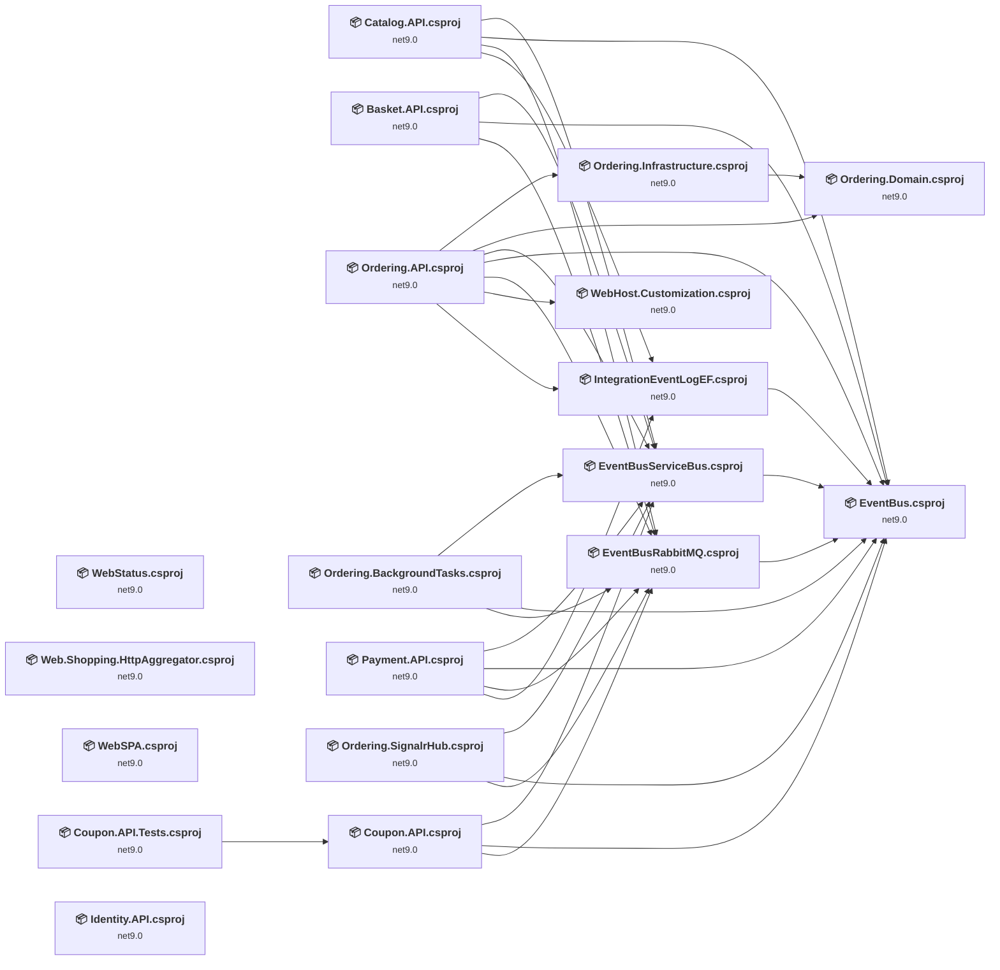

## Project Details

### src\ApiGateways\Aggregators\Web.Shopping.HttpAggregator\Web.Shopping.HttpAggregator.csproj

#### Project Info

- **Current Target Framework:** net9.0
- **Proposed Target Framework:** net10.0
- **SDK-style**: True
- **Project Kind:** AspNetCore
- **Dependencies**: 0
- **Dependants**: 0
- **Number of Files**: 31
- **Number of Files with Incidents**: 9
- **Lines of Code**: 1374
- **Estimated LOC to modify**: 48+ (at least 3,5% of the project)

#### Dependency Graph

Legend:
📦 SDK-style project
⚙️ Classic project

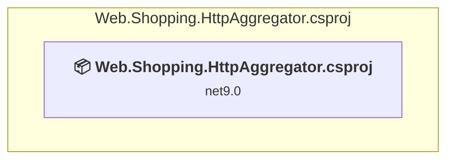

### API Compatibility

| Category | Count | Impact |
| :--- | :---: | :--- |
| 🔴 Binary Incompatible | 6 | High - Require code changes |
| 🟡 Source Incompatible | 19 | Medium - Needs re-compilation and potential conflicting API error fixing |
| 🔵 Behavioral change | 23 | Low - Behavioral changes that may require testing at runtime |
| ✅ Compatible | 5248 |  |
| ***Total APIs Analyzed*** | ***5296*** |  |

#### Project Technologies and Features

| Technology | Issues | Percentage | Migration Path |
| :--- | :---: | :---: | :--- |
| IdentityModel & Claims-based Security | 2 | 4,2% | Windows Identity Foundation (WIF), SAML, and claims-based authentication APIs that have been replaced by modern identity libraries. WIF was the original identity framework for .NET Framework. Migrate to Microsoft.IdentityModel.* packages (modern identity stack). |

### src\BuildingBlocks\EventBus\EventBus\EventBus.csproj

#### Project Info

- **Current Target Framework:** net9.0
- **Proposed Target Framework:** net10.0
- **SDK-style**: True
- **Project Kind:** ClassLibrary
- **Dependencies**: 0
- **Dependants**: 10
- **Number of Files**: 8
- **Number of Files with Incidents**: 1
- **Lines of Code**: 335
- **Estimated LOC to modify**: 0+ (at least 0,0% of the project)

#### Dependency Graph

Legend:
📦 SDK-style project
⚙️ Classic project

```mermaid
flowchart TB
    subgraph upstream["Dependants (10)"]
        P2["<b>📦&nbsp;Catalog.API.csproj</b><br/><small>net9.0</small>"]
        P4["<b>📦&nbsp;EventBusRabbitMQ.csproj</b><br/><small>net9.0</small>"]
        P5["<b>📦&nbsp;EventBusServiceBus.csproj</b><br/><small>net9.0</small>"]
        P6["<b>📦&nbsp;IntegrationEventLogEF.csproj</b><br/><small>net9.0</small>"]
        P8["<b>📦&nbsp;Basket.API.csproj</b><br/><small>net9.0</small>"]
        P9["<b>📦&nbsp;Ordering.API.csproj</b><br/><small>net9.0</small>"]
        P14["<b>📦&nbsp;Ordering.BackgroundTasks.csproj</b><br/><small>net9.0</small>"]
        P15["<b>📦&nbsp;Payment.API.csproj</b><br/><small>net9.0</small>"]
        P16["<b>📦&nbsp;Ordering.SignalrHub.csproj</b><br/><small>net9.0</small>"]
        P17["<b>📦&nbsp;Coupon.API.csproj</b><br/><small>net9.0</small>"]
        click P2 "#srcservicescatalogcatalogapicatalogapicsproj"
        click P4 "#srcbuildingblockseventbuseventbusrabbitmqeventbusrabbitmqcsproj"
        click P5 "#srcbuildingblockseventbuseventbusservicebuseventbusservicebuscsproj"
        click P6 "#srcbuildingblockseventbusintegrationeventlogefintegrationeventlogefcsproj"
        click P8 "#srcservicesbasketbasketapibasketapicsproj"
        click P9 "#srcservicesorderingorderingapiorderingapicsproj"
        click P14 "#srcservicesorderingorderingbackgroundtasksorderingbackgroundtaskscsproj"
        click P15 "#srcservicespaymentpaymentapipaymentapicsproj"
        click P16 "#srcservicesorderingorderingsignalrhuborderingsignalrhubcsproj"
        click P17 "#srcservicescouponcouponapicouponapicsproj"
    end
    subgraph current["EventBus.csproj"]
        MAIN["<b>📦&nbsp;EventBus.csproj</b><br/><small>net9.0</small>"]
        click MAIN "#srcbuildingblockseventbuseventbuseventbuscsproj"
    end
    P2 --> MAIN
    P4 --> MAIN
    P5 --> MAIN
    P6 --> MAIN
    P8 --> MAIN
    P9 --> MAIN
    P14 --> MAIN
    P15 --> MAIN
    P16 --> MAIN
    P17 --> MAIN

```

### API Compatibility

| Category | Count | Impact |
| :--- | :---: | :--- |
| 🔴 Binary Incompatible | 0 | High - Require code changes |
| 🟡 Source Incompatible | 0 | Medium - Needs re-compilation and potential conflicting API error fixing |
| 🔵 Behavioral change | 0 | Low - Behavioral changes that may require testing at runtime |
| ✅ Compatible | 265 |  |
| ***Total APIs Analyzed*** | ***265*** |  |

### src\BuildingBlocks\EventBus\EventBusRabbitMQ\EventBusRabbitMQ.csproj

#### Project Info

- **Current Target Framework:** net9.0
- **Proposed Target Framework:** net10.0
- **SDK-style**: True
- **Project Kind:** ClassLibrary
- **Dependencies**: 1
- **Dependants**: 7
- **Number of Files**: 3
- **Number of Files with Incidents**: 3
- **Lines of Code**: 447
- **Estimated LOC to modify**: 2+ (at least 0,4% of the project)

#### Dependency Graph

Legend:
📦 SDK-style project
⚙️ Classic project

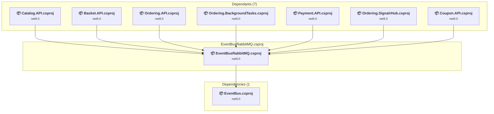

### API Compatibility

| Category | Count | Impact |
| :--- | :---: | :--- |
| 🔴 Binary Incompatible | 0 | High - Require code changes |
| 🟡 Source Incompatible | 2 | Medium - Needs re-compilation and potential conflicting API error fixing |
| 🔵 Behavioral change | 0 | Low - Behavioral changes that may require testing at runtime |
| ✅ Compatible | 372 |  |
| ***Total APIs Analyzed*** | ***374*** |  |

### src\BuildingBlocks\EventBus\EventBusServiceBus\EventBusServiceBus.csproj

#### Project Info

- **Current Target Framework:** net9.0
- **Proposed Target Framework:** net10.0
- **SDK-style**: True
- **Project Kind:** ClassLibrary
- **Dependencies**: 1
- **Dependants**: 7
- **Number of Files**: 3
- **Number of Files with Incidents**: 1
- **Lines of Code**: 264
- **Estimated LOC to modify**: 0+ (at least 0,0% of the project)

#### Dependency Graph

Legend:
📦 SDK-style project
⚙️ Classic project

### API Compatibility

| Category | Count | Impact |
| :--- | :---: | :--- |
| 🔴 Binary Incompatible | 0 | High - Require code changes |
| 🟡 Source Incompatible | 0 | Medium - Needs re-compilation and potential conflicting API error fixing |
| 🔵 Behavioral change | 0 | Low - Behavioral changes that may require testing at runtime |
| ✅ Compatible | 299 |  |
| ***Total APIs Analyzed*** | ***299*** |  |

### src\BuildingBlocks\EventBus\IntegrationEventLogEF\IntegrationEventLogEF.csproj

#### Project Info

- **Current Target Framework:** net9.0
- **Proposed Target Framework:** net10.0
- **SDK-style**: True
- **Project Kind:** ClassLibrary
- **Dependencies**: 1
- **Dependants**: 3
- **Number of Files**: 6
- **Number of Files with Incidents**: 1
- **Lines of Code**: 256
- **Estimated LOC to modify**: 0+ (at least 0,0% of the project)

#### Dependency Graph

Legend:
📦 SDK-style project
⚙️ Classic project

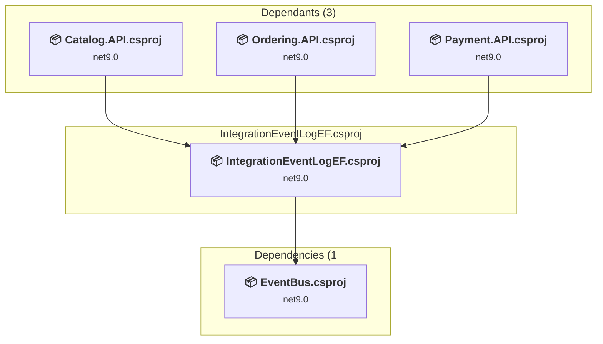

### API Compatibility

| Category | Count | Impact |
| :--- | :---: | :--- |
| 🔴 Binary Incompatible | 0 | High - Require code changes |
| 🟡 Source Incompatible | 0 | Medium - Needs re-compilation and potential conflicting API error fixing |
| 🔵 Behavioral change | 0 | Low - Behavioral changes that may require testing at runtime |
| ✅ Compatible | 331 |  |
| ***Total APIs Analyzed*** | ***331*** |  |

### src\BuildingBlocks\WebHost\WebHost.Customization\WebHost.Customization.csproj

#### Project Info

- **Current Target Framework:** net9.0
- **Proposed Target Framework:** net10.0
- **SDK-style**: True
- **Project Kind:** ClassLibrary
- **Dependencies**: 0
- **Dependants**: 1
- **Number of Files**: 1
- **Number of Files with Incidents**: 2
- **Lines of Code**: 79
- **Estimated LOC to modify**: 5+ (at least 6,3% of the project)

#### Dependency Graph

Legend:
📦 SDK-style project
⚙️ Classic project

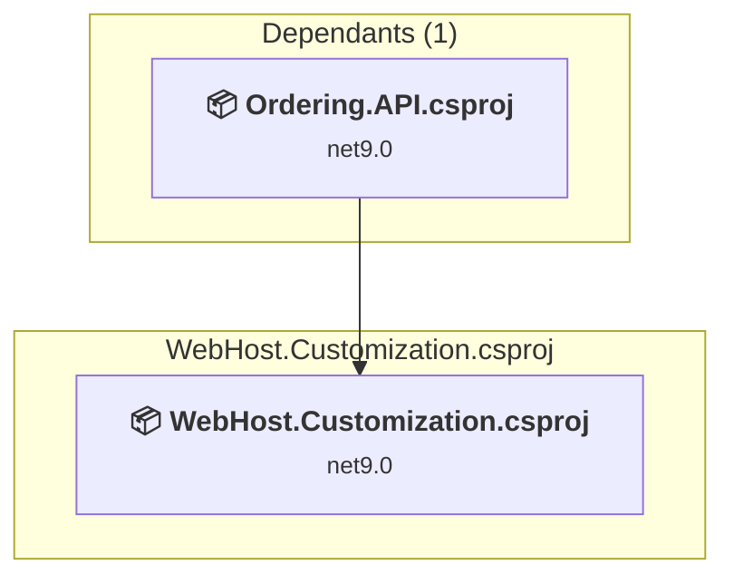

### API Compatibility

| Category | Count | Impact |
| :--- | :---: | :--- |
| 🔴 Binary Incompatible | 1 | High - Require code changes |
| 🟡 Source Incompatible | 4 | Medium - Needs re-compilation and potential conflicting API error fixing |
| 🔵 Behavioral change | 0 | Low - Behavioral changes that may require testing at runtime |
| ✅ Compatible | 73 |  |
| ***Total APIs Analyzed*** | ***78*** |  |

### src\Services\Basket\Basket.API\Basket.API.csproj

#### Project Info

- **Current Target Framework:** net9.0
- **Proposed Target Framework:** net10.0
- **SDK-style**: True
- **Project Kind:** AspNetCore
- **Dependencies**: 3
- **Dependants**: 0
- **Number of Files**: 36
- **Number of Files with Incidents**: 4
- **Lines of Code**: 1602
- **Estimated LOC to modify**: 33+ (at least 2,1% of the project)

#### Dependency Graph

Legend:
📦 SDK-style project
⚙️ Classic project

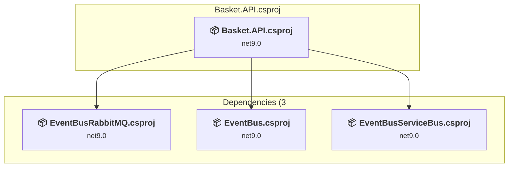

### API Compatibility

| Category | Count | Impact |
| :--- | :---: | :--- |
| 🔴 Binary Incompatible | 11 | High - Require code changes |
| 🟡 Source Incompatible | 16 | Medium - Needs re-compilation and potential conflicting API error fixing |
| 🔵 Behavioral change | 6 | Low - Behavioral changes that may require testing at runtime |
| ✅ Compatible | 2894 |  |
| ***Total APIs Analyzed*** | ***2927*** |  |

#### Project Technologies and Features

| Technology | Issues | Percentage | Migration Path |
| :--- | :---: | :---: | :--- |
| IdentityModel & Claims-based Security | 2 | 6,1% | Windows Identity Foundation (WIF), SAML, and claims-based authentication APIs that have been replaced by modern identity libraries. WIF was the original identity framework for .NET Framework. Migrate to Microsoft.IdentityModel.* packages (modern identity stack). |

### src\Services\Catalog\Catalog.API\Catalog.API.csproj

#### Project Info

- **Current Target Framework:** net9.0
- **Proposed Target Framework:** net10.0
- **SDK-style**: True
- **Project Kind:** AspNetCore
- **Dependencies**: 4
- **Dependants**: 0
- **Number of Files**: 78
- **Number of Files with Incidents**: 7
- **Lines of Code**: 4102
- **Estimated LOC to modify**: 30+ (at least 0,7% of the project)

#### Dependency Graph

Legend:
📦 SDK-style project
⚙️ Classic project

### API Compatibility

| Category | Count | Impact |
| :--- | :---: | :--- |
| 🔴 Binary Incompatible | 9 | High - Require code changes |
| 🟡 Source Incompatible | 21 | Medium - Needs re-compilation and potential conflicting API error fixing |
| 🔵 Behavioral change | 0 | Low - Behavioral changes that may require testing at runtime |
| ✅ Compatible | 6082 |  |
| ***Total APIs Analyzed*** | ***6112*** |  |

### src\Services\Coupon\Coupon.API\Coupon.API.csproj

#### Project Info

- **Current Target Framework:** net9.0
- **Proposed Target Framework:** net10.0
- **SDK-style**: True
- **Project Kind:** AspNetCore
- **Dependencies**: 3
- **Dependants**: 1
- **Number of Files**: 25
- **Number of Files with Incidents**: 4
- **Lines of Code**: 945
- **Estimated LOC to modify**: 27+ (at least 2,9% of the project)

#### Dependency Graph

Legend:
📦 SDK-style project
⚙️ Classic project

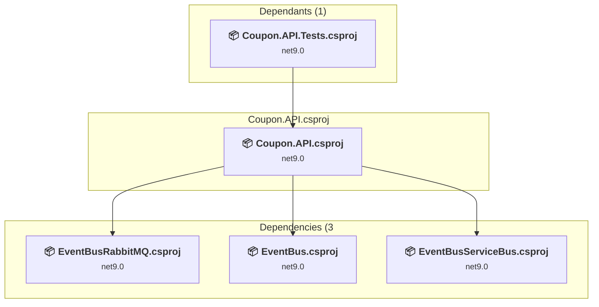

### API Compatibility

| Category | Count | Impact |
| :--- | :---: | :--- |
| 🔴 Binary Incompatible | 8 | High - Require code changes |
| 🟡 Source Incompatible | 13 | Medium - Needs re-compilation and potential conflicting API error fixing |
| 🔵 Behavioral change | 6 | Low - Behavioral changes that may require testing at runtime |
| ✅ Compatible | 1040 |  |
| ***Total APIs Analyzed*** | ***1067*** |  |

### src\Services\Identity\Identity.API\Identity.API.csproj

#### Project Info

- **Current Target Framework:** net9.0
- **Proposed Target Framework:** net10.0
- **SDK-style**: True
- **Project Kind:** AspNetCore
- **Dependencies**: 0
- **Dependants**: 0
- **Number of Files**: 83
- **Number of Files with Incidents**: 4
- **Lines of Code**: 1468
- **Estimated LOC to modify**: 24+ (at least 1,6% of the project)

#### Dependency Graph

Legend:
📦 SDK-style project
⚙️ Classic project

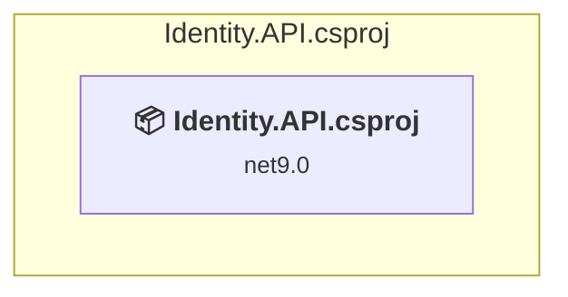

### API Compatibility

| Category | Count | Impact |
| :--- | :---: | :--- |
| 🔴 Binary Incompatible | 11 | High - Require code changes |
| 🟡 Source Incompatible | 13 | Medium - Needs re-compilation and potential conflicting API error fixing |
| 🔵 Behavioral change | 0 | Low - Behavioral changes that may require testing at runtime |
| ✅ Compatible | 2004 |  |
| ***Total APIs Analyzed*** | ***2028*** |  |

#### Project Technologies and Features

| Technology | Issues | Percentage | Migration Path |
| :--- | :---: | :---: | :--- |
| IdentityModel & Claims-based Security | 9 | 37,5% | Windows Identity Foundation (WIF), SAML, and claims-based authentication APIs that have been replaced by modern identity libraries. WIF was the original identity framework for .NET Framework. Migrate to Microsoft.IdentityModel.* packages (modern identity stack). |

### src\Services\Ordering\Ordering.API\Ordering.API.csproj

#### Project Info

- **Current Target Framework:** net9.0
- **Proposed Target Framework:** net10.0
- **SDK-style**: True
- **Project Kind:** AspNetCore
- **Dependencies**: 7
- **Dependants**: 0
- **Number of Files**: 121
- **Number of Files with Incidents**: 7
- **Lines of Code**: 8744
- **Estimated LOC to modify**: 52+ (at least 0,6% of the project)

#### Dependency Graph

Legend:
📦 SDK-style project
⚙️ Classic project

```mermaid
flowchart TB
    subgraph current["Ordering.API.csproj"]
        MAIN["<b>📦&nbsp;Ordering.API.csproj</b><br/><small>net9.0</small>"]
        click MAIN "#srcservicesorderingorderingapiorderingapicsproj"
    end
    subgraph downstream["Dependencies (7"]
        P6["<b>📦&nbsp;IntegrationEventLogEF.csproj</b><br/><small>net9.0</small>"]
        P10["<b>📦&nbsp;WebHost.Customization.csproj</b><br/><small>net9.0</small>"]
        P4["<b>📦&nbsp;EventBusRabbitMQ.csproj</b><br/><small>net9.0</small>"]
        P3["<b>📦&nbsp;EventBus.csproj</b><br/><small>net9.0</small>"]
        P5["<b>📦&nbsp;EventBusServiceBus.csproj</b><br/><small>net9.0</small>"]
        P11["<b>📦&nbsp;Ordering.Domain.csproj</b><br/><small>net9.0</small>"]
        P12["<b>📦&nbsp;Ordering.Infrastructure.csproj</b><br/><small>net9.0</small>"]
        click P6 "#srcbuildingblockseventbusintegrationeventlogefintegrationeventlogefcsproj"
        click P10 "#srcbuildingblockswebhostwebhostcustomizationwebhostcustomizationcsproj"
        click P4 "#srcbuildingblockseventbuseventbusrabbitmqeventbusrabbitmqcsproj"
        click P3 "#srcbuildingblockseventbuseventbuseventbuscsproj"
        click P5 "#srcbuildingblockseventbuseventbusservicebuseventbusservicebuscsproj"
        click P11 "#srcservicesorderingorderingdomainorderingdomaincsproj"
        click P12 "#srcservicesorderingorderinginfrastructureorderinginfrastructurecsproj"
    end
    MAIN --> P6
    MAIN --> P10
    MAIN --> P4
    MAIN --> P3
    MAIN --> P5
    MAIN --> P11
    MAIN --> P12

```

### API Compatibility

| Category | Count | Impact |
| :--- | :---: | :--- |
| 🔴 Binary Incompatible | 11 | High - Require code changes |
| 🟡 Source Incompatible | 35 | Medium - Needs re-compilation and potential conflicting API error fixing |
| 🔵 Behavioral change | 6 | Low - Behavioral changes that may require testing at runtime |
| ✅ Compatible | 11068 |  |
| ***Total APIs Analyzed*** | ***11120*** |  |

#### Project Technologies and Features

| Technology | Issues | Percentage | Migration Path |
| :--- | :---: | :---: | :--- |
| IdentityModel & Claims-based Security | 2 | 3,8% | Windows Identity Foundation (WIF), SAML, and claims-based authentication APIs that have been replaced by modern identity libraries. WIF was the original identity framework for .NET Framework. Migrate to Microsoft.IdentityModel.* packages (modern identity stack). |

### src\Services\Ordering\Ordering.BackgroundTasks\Ordering.BackgroundTasks.csproj

#### Project Info

- **Current Target Framework:** net9.0
- **Proposed Target Framework:** net10.0
- **SDK-style**: True
- **Project Kind:** DotNetCoreApp
- **Dependencies**: 3
- **Dependants**: 0
- **Number of Files**: 8
- **Number of Files with Incidents**: 3
- **Lines of Code**: 349
- **Estimated LOC to modify**: 3+ (at least 0,9% of the project)

#### Dependency Graph

Legend:
📦 SDK-style project
⚙️ Classic project

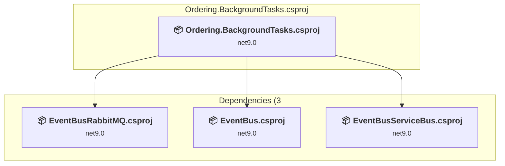

### API Compatibility

| Category | Count | Impact |
| :--- | :---: | :--- |
| 🔴 Binary Incompatible | 3 | High - Require code changes |
| 🟡 Source Incompatible | 0 | Medium - Needs re-compilation and potential conflicting API error fixing |
| 🔵 Behavioral change | 0 | Low - Behavioral changes that may require testing at runtime |
| ✅ Compatible | 409 |  |
| ***Total APIs Analyzed*** | ***412*** |  |

### src\Services\Ordering\Ordering.Domain\Ordering.Domain.csproj

#### Project Info

- **Current Target Framework:** net9.0
- **Proposed Target Framework:** net10.0
- **SDK-style**: True
- **Project Kind:** ClassLibrary
- **Dependencies**: 0
- **Dependants**: 2
- **Number of Files**: 24
- **Number of Files with Incidents**: 1
- **Lines of Code**: 1022
- **Estimated LOC to modify**: 0+ (at least 0,0% of the project)

#### Dependency Graph

Legend:
📦 SDK-style project
⚙️ Classic project

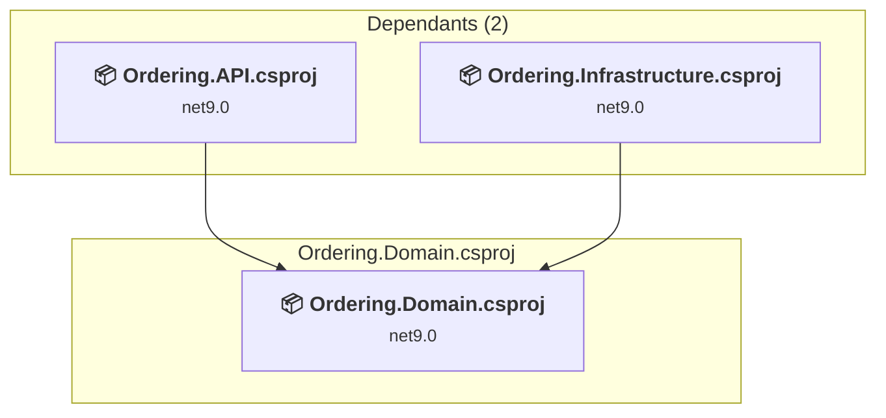

### API Compatibility

| Category | Count | Impact |
| :--- | :---: | :--- |
| 🔴 Binary Incompatible | 0 | High - Require code changes |
| 🟡 Source Incompatible | 0 | Medium - Needs re-compilation and potential conflicting API error fixing |
| 🔵 Behavioral change | 0 | Low - Behavioral changes that may require testing at runtime |
| ✅ Compatible | 933 |  |
| ***Total APIs Analyzed*** | ***933*** |  |

### src\Services\Ordering\Ordering.Infrastructure\Ordering.Infrastructure.csproj

#### Project Info

- **Current Target Framework:** net9.0
- **Proposed Target Framework:** net10.0
- **SDK-style**: True
- **Project Kind:** ClassLibrary
- **Dependencies**: 1
- **Dependants**: 1
- **Number of Files**: 14
- **Number of Files with Incidents**: 1
- **Lines of Code**: 725
- **Estimated LOC to modify**: 0+ (at least 0,0% of the project)

#### Dependency Graph

Legend:
📦 SDK-style project
⚙️ Classic project

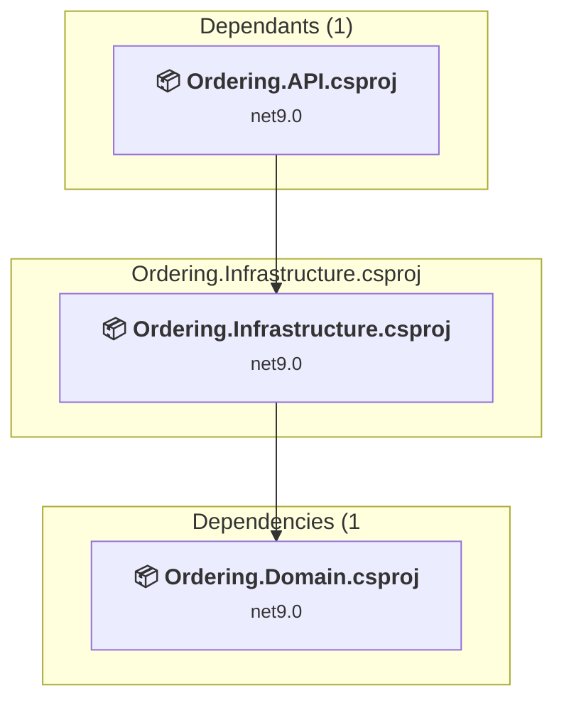

### API Compatibility

| Category | Count | Impact |
| :--- | :---: | :--- |
| 🔴 Binary Incompatible | 0 | High - Require code changes |
| 🟡 Source Incompatible | 0 | Medium - Needs re-compilation and potential conflicting API error fixing |
| 🔵 Behavioral change | 0 | Low - Behavioral changes that may require testing at runtime |
| ✅ Compatible | 741 |  |
| ***Total APIs Analyzed*** | ***741*** |  |

### src\Services\Ordering\Ordering.SignalrHub\Ordering.SignalrHub.csproj

#### Project Info

- **Current Target Framework:** net9.0
- **Proposed Target Framework:** net10.0
- **SDK-style**: True
- **Project Kind:** AspNetCore
- **Dependencies**: 3
- **Dependants**: 0
- **Number of Files**: 19
- **Number of Files with Incidents**: 3
- **Lines of Code**: 815
- **Estimated LOC to modify**: 20+ (at least 2,5% of the project)

#### Dependency Graph

Legend:
📦 SDK-style project
⚙️ Classic project

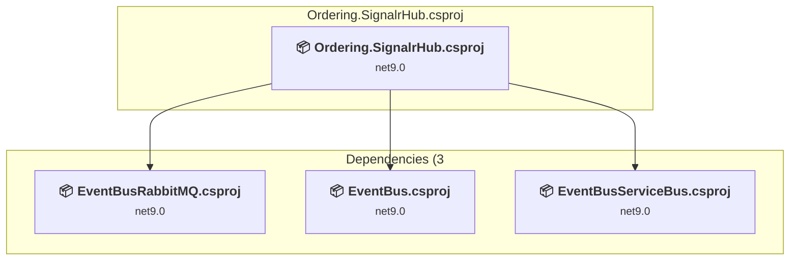

### API Compatibility

| Category | Count | Impact |
| :--- | :---: | :--- |
| 🔴 Binary Incompatible | 7 | High - Require code changes |
| 🟡 Source Incompatible | 13 | Medium - Needs re-compilation and potential conflicting API error fixing |
| 🔵 Behavioral change | 0 | Low - Behavioral changes that may require testing at runtime |
| ✅ Compatible | 950 |  |
| ***Total APIs Analyzed*** | ***970*** |  |

#### Project Technologies and Features

| Technology | Issues | Percentage | Migration Path |
| :--- | :---: | :---: | :--- |
| IdentityModel & Claims-based Security | 2 | 10,0% | Windows Identity Foundation (WIF), SAML, and claims-based authentication APIs that have been replaced by modern identity libraries. WIF was the original identity framework for .NET Framework. Migrate to Microsoft.IdentityModel.* packages (modern identity stack). |

### src\Services\Payment\Payment.API\Payment.API.csproj

#### Project Info

- **Current Target Framework:** net9.0
- **Proposed Target Framework:** net10.0
- **SDK-style**: True
- **Project Kind:** AspNetCore
- **Dependencies**: 4
- **Dependants**: 0
- **Number of Files**: 9
- **Number of Files with Incidents**: 3
- **Lines of Code**: 397
- **Estimated LOC to modify**: 10+ (at least 2,5% of the project)

#### Dependency Graph

Legend:
📦 SDK-style project
⚙️ Classic project

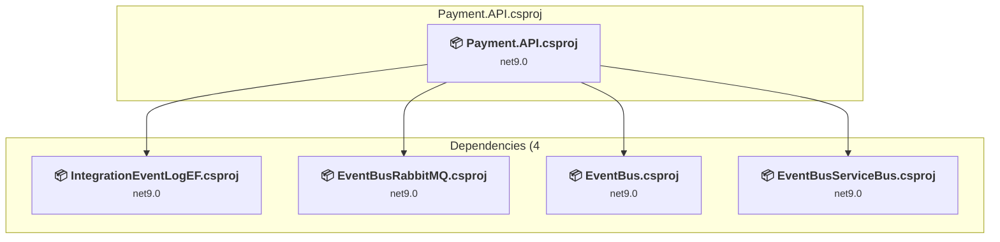

### API Compatibility

| Category | Count | Impact |
| :--- | :---: | :--- |
| 🔴 Binary Incompatible | 5 | High - Require code changes |
| 🟡 Source Incompatible | 5 | Medium - Needs re-compilation and potential conflicting API error fixing |
| 🔵 Behavioral change | 0 | Low - Behavioral changes that may require testing at runtime |
| ✅ Compatible | 442 |  |
| ***Total APIs Analyzed*** | ***452*** |  |

### src\Web\WebSPA\WebSPA.csproj

#### Project Info

- **Current Target Framework:** net9.0
- **Proposed Target Framework:** net10.0
- **SDK-style**: True
- **Project Kind:** AspNetCore
- **Dependencies**: 0
- **Dependants**: 0
- **Number of Files**: 15
- **Number of Files with Incidents**: 3
- **Lines of Code**: 328
- **Estimated LOC to modify**: 27+ (at least 8,2% of the project)

#### Dependency Graph

Legend:
📦 SDK-style project
⚙️ Classic project

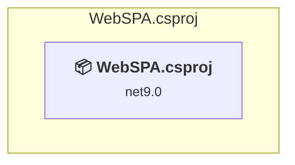

### API Compatibility

| Category | Count | Impact |
| :--- | :---: | :--- |
| 🔴 Binary Incompatible | 2 | High - Require code changes |
| 🟡 Source Incompatible | 18 | Medium - Needs re-compilation and potential conflicting API error fixing |
| 🔵 Behavioral change | 7 | Low - Behavioral changes that may require testing at runtime |
| ✅ Compatible | 426 |  |
| ***Total APIs Analyzed*** | ***453*** |  |

### src\Web\WebStatus\WebStatus.csproj

#### Project Info

- **Current Target Framework:** net9.0
- **Proposed Target Framework:** net10.0
- **SDK-style**: True
- **Project Kind:** AspNetCore
- **Dependencies**: 0
- **Dependants**: 0
- **Number of Files**: 11
- **Number of Files with Incidents**: 3
- **Lines of Code**: 312
- **Estimated LOC to modify**: 13+ (at least 4,2% of the project)

#### Dependency Graph

Legend:
📦 SDK-style project
⚙️ Classic project

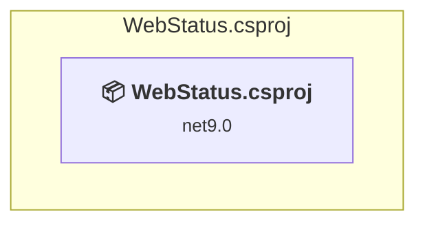

### API Compatibility

| Category | Count | Impact |
| :--- | :---: | :--- |
| 🔴 Binary Incompatible | 2 | High - Require code changes |
| 🟡 Source Incompatible | 10 | Medium - Needs re-compilation and potential conflicting API error fixing |
| 🔵 Behavioral change | 1 | Low - Behavioral changes that may require testing at runtime |
| ✅ Compatible | 651 |  |
| ***Total APIs Analyzed*** | ***664*** |  |

### tests\Services\Coupon\Coupon.API.Tests\Coupon.API.Tests.csproj

#### Project Info

- **Current Target Framework:** net9.0
- **Proposed Target Framework:** net10.0
- **SDK-style**: True
- **Project Kind:** DotNetCoreApp
- **Dependencies**: 1
- **Dependants**: 0
- **Number of Files**: 3
- **Number of Files with Incidents**: 1
- **Lines of Code**: 13
- **Estimated LOC to modify**: 0+ (at least 0,0% of the project)

#### Dependency Graph

Legend:
📦 SDK-style project
⚙️ Classic project

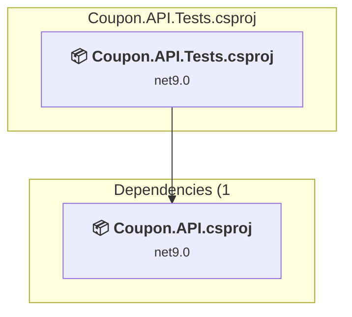

### API Compatibility

| Category | Count | Impact |
| :--- | :---: | :--- |
| 🔴 Binary Incompatible | 0 | High - Require code changes |
| 🟡 Source Incompatible | 0 | Medium - Needs re-compilation and potential conflicting API error fixing |
| 🔵 Behavioral change | 0 | Low - Behavioral changes that may require testing at runtime |
| ✅ Compatible | 7 |  |
| ***Total APIs Analyzed*** | ***7*** |  |

